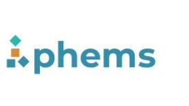
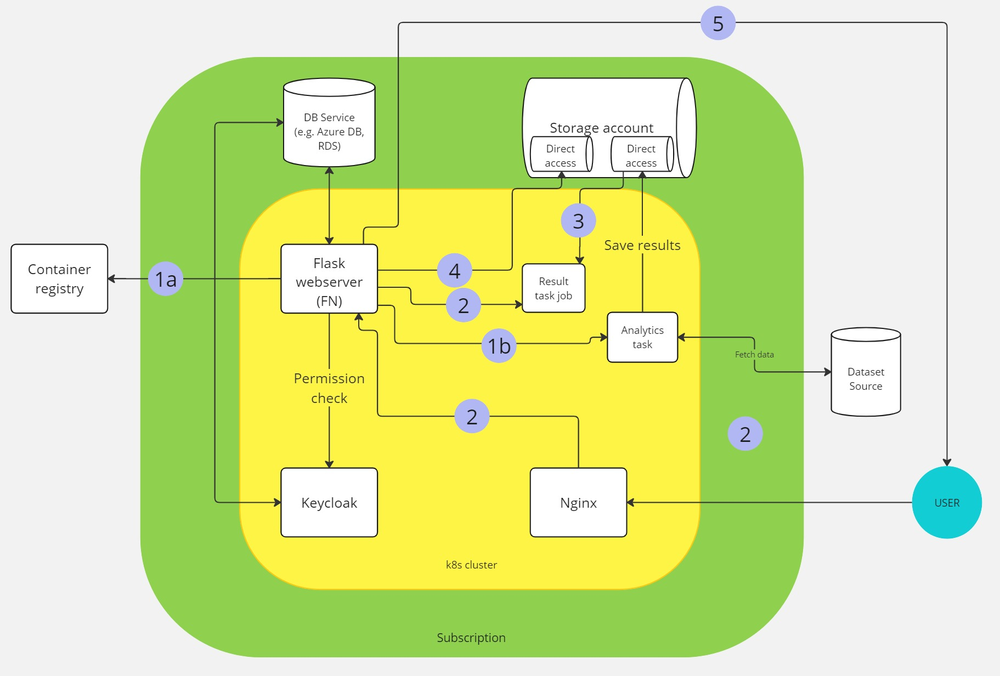

# PHEMS - Federated Node

[PHEMS](https://phems.eu/) (short for "Pediatric Hospitals as European drivers for multi-party computation and synthetic data generation capabilities across clinical specialities and data types") is a Europe-wide consortium of paediatric hospitals that:

> ...aims to revolutionize the way health data is managed and utilized across Europe. This project is particularly focused on addressing the challenges posed by privacy concerns and the complexity of data sharing due to varying interpretations of the EU General Data Protection Regulation (GDPR). By developing a decentralized and open health data ecosystem, PHEMS strives to facilitate easier access to health data, thereby advancing federated health data analysis and creating services for generating shareable synthetic datasets.

As a technical partner of the project Aridhia has developed the Federated Node an open source component for running federated tasks.

- [Setting up git apps](SETUP_GIT_APPS.md): GitHub App and Gitea OAuth credentials for repositories.

## Project

The Federated Node is based on three existing open source projects:

- [The Common API](https://github.com/federated-data-sharing/common-api/tree/master)
- [Keycloak](https://github.com/keycloak)
- [Traefik](https://github.com/traefik/traefik)

The Common API provides the structure of the API calls, Keycloak is used for token and user management, and Traefik is used as a reverse proxy. The FN needs to be deployed to a Kubernetes cluster, and requires a Postgres database for storing user credentials.



|  | Description                                                                                                                                          |
|------|------------------------------------------------------------------------------------------------------------------------------------------------------|
| 1a   | Before creating the task pod, the FN checks if the docker image needed can be found in any of the docker container registries associated with the FN |
| 1b   | The task pod is created and the results are saved in the storage account                                                                             |
| 2    | On /results calls, if the task pod is on completed status, a job is created.                                                                         |
| 3    | The job's pod will have the 2 storage environments mounted. It fetches the tasks result folder and zips it                                           |
| 4    | The nexus-api reads the zip contents from the live job pod and saves it in its own storage account environment.                                      |
| 5    | The resulting archive is returned to the end user                                                                                                    |

Licences for the component projects can be found [here](https://github.com/Aridhia-Open-Source/PHEMS_federated_node/tree/main/sub-licenses).

## Development

### Dependency Management

Python dependencies are declared in `pyproject.toml` files within each component directory (e.g. `nexus/api/`, `build/alpine/`, `build/kc-init/`). Locked `requirements.txt` files are generated from these using [pip-tools](https://pip-tools.readthedocs.io/) via the `pip-compile` mise task.

#### Prerequisites

Install `pip-tools` in your local environment:

```bash
python -m pip install pip-tools
```

#### Locking Requirements

Run `mise run pip-compile` with the target component directory as `--dir`:

```bash
# Lock dependencies for nexus/api
mise run pip-compile --dir nexus/api

# Lock dependencies for a build component
mise run pip-compile --dir build/kc-init
```

By default this writes `requirements.txt` in the given directory. To write to a different output file, pass it with `--out`:

```bash
mise run pip-compile --dir nexus/api --out requirements-dev.txt
```

Any additional flags supported by `pip-compile` go after `--`, e.g. `mise run pip-compile --dir nexus/api -- --upgrade`.
To view the default flags see `scripts/pip_compile.sh`.

#### Modifying Dependencies

1. Edit the `dependencies` list in the relevant `pyproject.toml`. Use `[project.optional-dependencies]` for dev/test-only extras.
2. Re-run `mise run pip-compile --dir <dir>` to regenerate the locked `requirements.txt`.
3. Commit both `pyproject.toml` and `requirements.txt`.

Use `~=` (compatible-release) specifiers in `pyproject.toml` to constrain the minor version while allowing patch updates, e.g. `"fastapi~=0.162.0"`. The locked `requirements.txt` pins exact versions with hashes for reproducible installs.

### Linting

#### Dockerfile linting

[hadolint](https://github.com/hadolint/hadolint) lints all `Dockerfile`s in the project. It runs inside Docker, so no local installation is required beyond Docker itself.

```bash
mise run hadolint
```

This prints any issues directly to the terminal in a readable format. It also writes a JUnit XML report to `artifacts/hadolint.xml`, which is consumed by CI.

## Running

### Local
See the [Run Locally](https://github.com/Aridhia-Open-Source/PHEMS_federated_node/wiki/Run-Locally) Wiki Page

## Deployment
See the [How to deploy](https://github.com/Aridhia-Open-Source/PHEMS_federated_node/wiki/How-to-deploy) Wiki Page.
