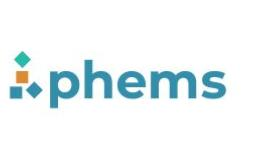
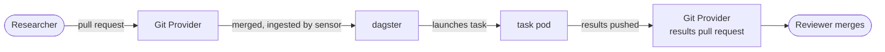
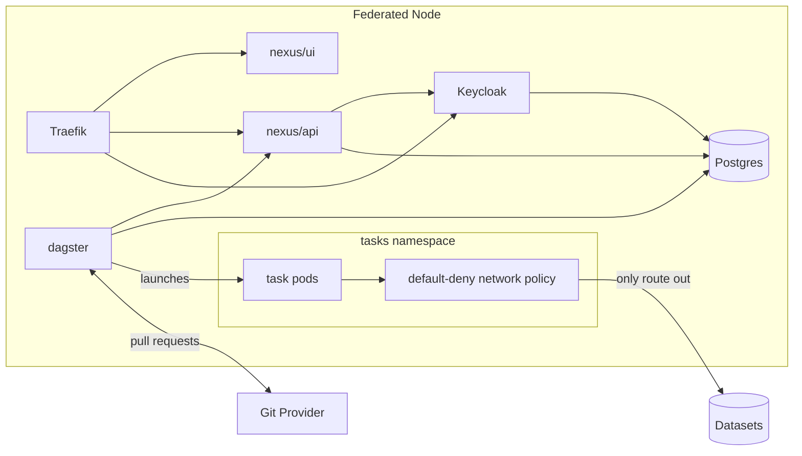

# PHEMS - Federated Node

The Federated Node runs analysis tasks next to sensitive data and lets out only results that someone has reviewed. Analytics code goes to the data, never the other way round. It deploys as a Helm chart onto Kubernetes, and was built by Aridhia as a technical partner of [PHEMS](https://phems.eu/).

## How it works

A researcher opens a pull request on a watched git repository, adding a task spec. When it is merged, the node creates a task and runs it in an isolated pod against one dataset. The results come back as a results pull request, which a reviewer merges or closes.

## Components

## Access

Keycloak signs people and programs in; nexus-api decides what each may do.

- Every account holds one of five fixed roles: `SuperUser` (recovery), `Administrator` (sets up the node), `Service` (the operator), `Users` and `Dagster`. A role is a Keycloak group under `/roles`, so a hospital can feed it from its own directory.
- What a person may do to a project or global record is a list of grants in nexus-api: `read`, `assign`, `execute`, `operate`, `write` or `manage`, for a user or a Keycloak group, optionally until a date. Every call is checked, reads included, by one reviewed Cedar policy file (`nexus/api/authz/`). Revoking applies at once.
- Install sets a first admin (`firstUserSecret`) and a break-glass superuser (`superuserSecret`).

Pages: [Sign-in and roles](docs/versions/2.x/docs/Sign-In-And-Roles.md), [Granting access](docs/versions/2.x/docs/Granting-Access.md), [Auth setup](docs/versions/2.x/docs/Auth-Setup.md). Design: ADRs [0035](project/decisions/0035-api-authorization-oidc-authentication.md), [0036](project/decisions/0036-keycloak-authentication-roles-and-system-accounts.md) and [0037](project/decisions/0037-cedar-authorization-grants-and-policies.md).

## Principles

- Pull request review is the approval: a task starts when its pull request is merged, and results leave the node only when a results pull request is merged.
- Tasks are isolated by default: each runs in its own pod in a separate namespace, and a default-deny network policy keeps it off the public internet.
- The node only pulls and reaches out. It polls the git provider and pushes results, and nothing outside has to call in to start a task.
- One record and its rules live in `nexus/api`: projects, datasets, repositories, tasks and results, and every state change. Dagster carries out what the API decides.

## Node config

A node's config (git providers, secrets, repositories, datasets, projects) can live in git as Helm values, applied by the nexus operator.

- With `operator.enabled`, the chart turns each `nodeConfig` entry into a custom resource (`fn.aridhia.com/v1alpha1`) in the operator's namespace, `fn-operator`. The operator creates, updates and soft-deletes the matching record in nexus-api.
- No secret values in values: a `NodeSecret` names the Kubernetes Secret its values are in, filled by External Secrets, SOPS or by hand.
- Review, repeat and revert config like the chart: merge and `helm upgrade` (or let Flux do it). `kubectl get fn -n fn-operator` shows what is synced.
- Turning the operator off or uninstalling keeps the records in nexus-api. Dev applies the same resources with `kubectl apply -f config/`.

Pages: [Node config](docs/versions/2.x/docs/Node-Config.md), [Node secrets](docs/versions/2.x/docs/Node-Secrets.md). Design: [ADR 0032](https://github.com/Aridhia-Open-Source/PHEMS_federated_node/pull/716).

## Deploying a site with Flux

A site's node is upgraded, reverted and configured by merging to a site-owned git repository. Flux, inside the node's cluster, pulls that repository from the node's own Gitea and upgrades the Helm release to the chart version it pins; Secrets are committed SOPS-encrypted. Nothing has to reach into the site. Why: [ADR 0031](project/decisions/0031-gitops-deployment-with-flux.md).

- Setting up a site: [Deploy with Flux](docs/versions/2.x/docs/Deploy-With-Flux.md), then [Flux secrets](docs/versions/2.x/docs/Flux-Secrets.md).
- Site repository kept outside the cluster: [Flux site repository mirror](docs/versions/2.x/docs/Flux-Site-Repository-Mirror.md).
- Trying it on the dev cluster: [Flux dev loop](docs/versions/2.x/docs/Flux-Dev-Loop.md) (`mise run flux publish|up|status|down`).

## Where to go next

- Deploying a node: [Deploy-Core](docs/versions/2.x/docs/Deploy-Core.md), plus the page for your platform ([Azure](docs/versions/2.x/docs/Deploy-Azure.md), [AWS](docs/versions/2.x/docs/Deploy-AWS.md), [GCP](docs/versions/2.x/docs/Deploy-GCP.md), [On-Premises](docs/versions/2.x/docs/Deploy-On-Premises.md)). Start with [Prerequisites](docs/versions/2.x/docs/Prerequisites.md).
- Running it locally: [DEPLOYMENT.md](DEPLOYMENT.md), "Run it locally".
- Who can sign in and who can do what: [Sign-in and roles](docs/versions/2.x/docs/Sign-In-And-Roles.md), [Granting access](docs/versions/2.x/docs/Granting-Access.md), [Auth setup](docs/versions/2.x/docs/Auth-Setup.md).
- Keeping node config in git: [Node config](docs/versions/2.x/docs/Node-Config.md), [Node secrets](docs/versions/2.x/docs/Node-Secrets.md).
- Setting up a project: [MANAGEMENT.md](MANAGEMENT.md), then [Datasets](docs/versions/2.x/docs/Datasets.md) and the [Researcher guide](docs/versions/2.x/docs/Researcher-Guide.md). Git credentials are in [SETUP_GIT_APPS.md](SETUP_GIT_APPS.md).
- Contributing: [AGENTS.md](AGENTS.md) for the repo map, mise tasks and conventions, and the [decision records](project/decisions/README.md).
- Licences for the component projects: [sub-licenses](https://github.com/Aridhia-Open-Source/PHEMS_federated_node/tree/main/sub-licenses).
