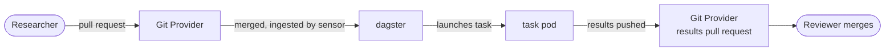
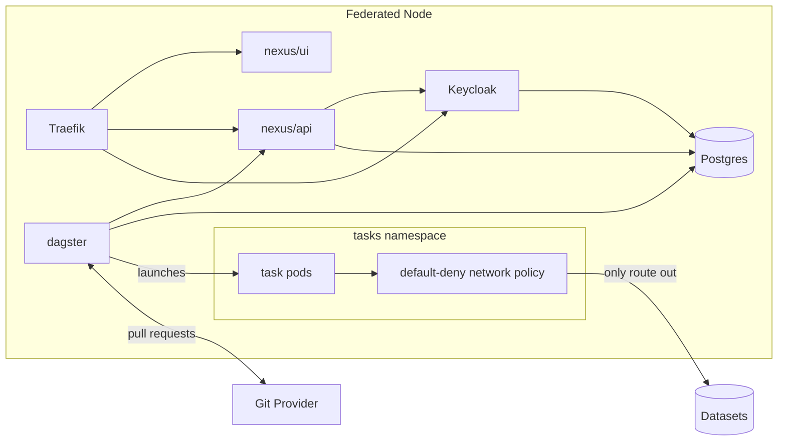

# PHEMS - Federated Node

The Federated Node runs analysis tasks next to sensitive data and lets out only results that someone has reviewed. Analytics code goes to the data, never the other way round. It deploys as a Helm chart onto Kubernetes, and was built by Aridhia as a technical partner of [PHEMS](https://phems.eu/).

## How it works

A researcher opens a pull request on a watched git repository, adding a task spec. When it is merged, the node creates a task and runs it in an isolated pod against one dataset. The results come back as a results pull request, which a reviewer merges or closes.

## Components

## Principles

- Pull request review is the approval: a task starts when its pull request is merged, and results leave the node only when a results pull request is merged.
- Tasks are isolated by default: each runs in its own pod in a separate namespace, and a default-deny network policy keeps it off the public internet.
- The node only pulls and reaches out. It polls the git provider and pushes results, and nothing outside has to call in to start a task.
- One record and its rules live in `nexus/api`: projects, datasets, repositories, tasks and results, and every state change. Dagster carries out what the API decides.

## Where to go next

- Deploying a node: [Deploy-Core](docs/wiki/Deploy-Core.md), plus the page for your platform ([Azure](docs/wiki/Deploy-Azure.md), [AWS](docs/wiki/Deploy-AWS.md), [GCP](docs/wiki/Deploy-GCP.md), [On-Premises](docs/wiki/Deploy-On-Premises.md)). Start with [Prerequisites](docs/wiki/Prerequisites.md).
- Running it locally: [DEPLOYMENT.md](DEPLOYMENT.md), "Run it locally".
- Setting up a project: [MANAGEMENT.md](MANAGEMENT.md), then [Datasets](docs/wiki/Datasets.md) and the [Researcher guide](docs/wiki/Researcher-Guide.md). Git credentials are in [SETUP_GIT_APPS.md](SETUP_GIT_APPS.md).
- Contributing: [AGENTS.md](AGENTS.md) for the repo map, mise tasks and conventions, and the [decision records](project/decisions/README.md).
- Licences for the component projects: [sub-licenses](https://github.com/Aridhia-Open-Source/PHEMS_federated_node/tree/main/sub-licenses).
