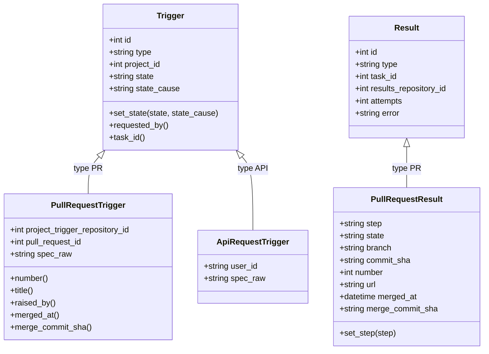
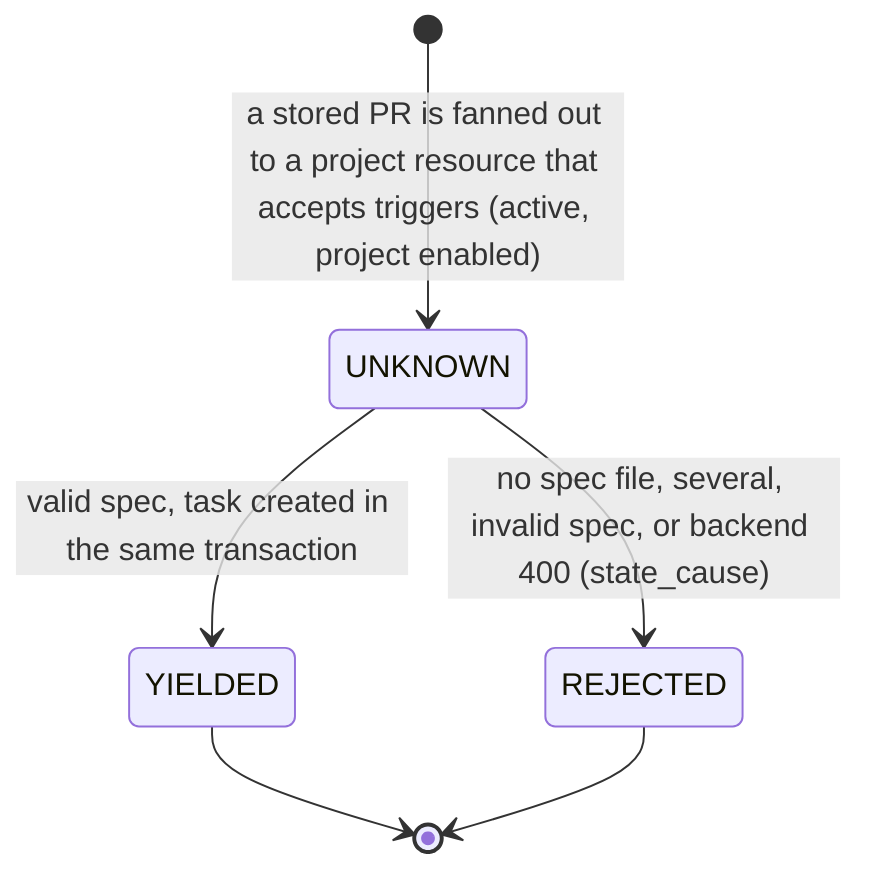
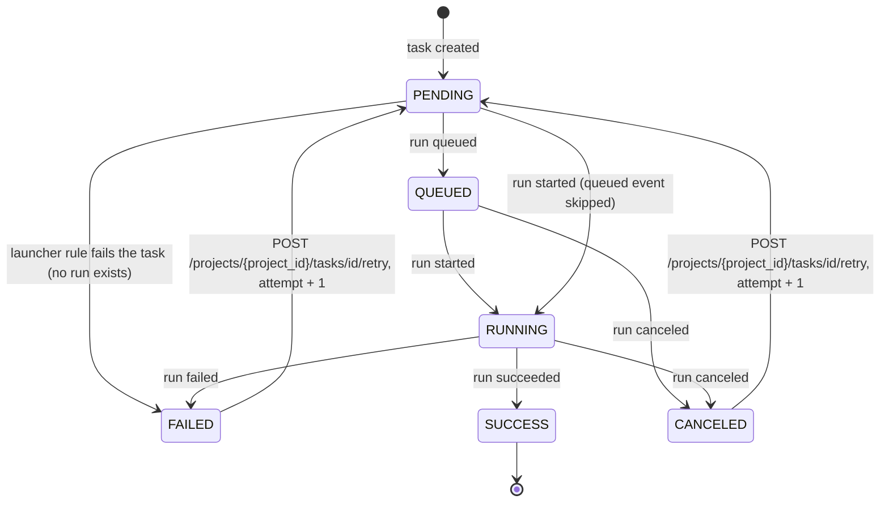
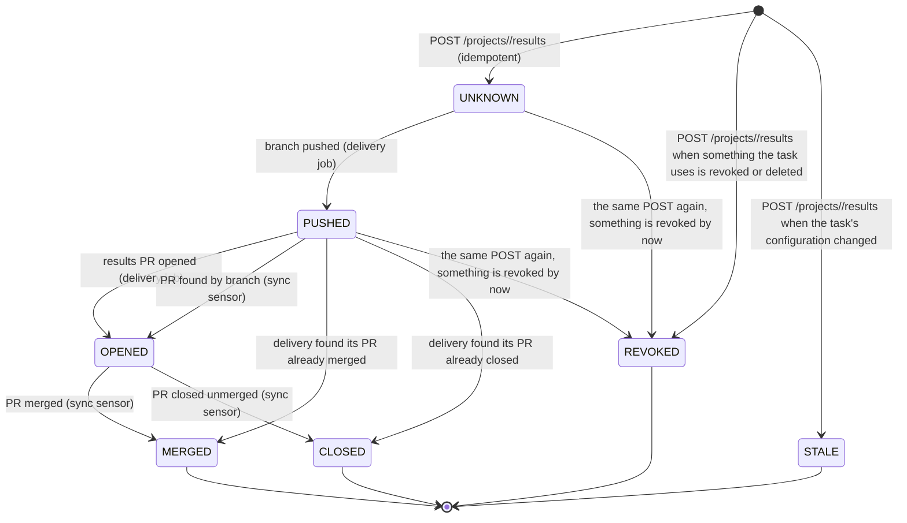

# Entities and state machines

The final backend schema (`webserver/migrations/versions/001_baseline.py`), the two inheritance trees, and the three state machines. Decisions: [0001](../../project/decisions/0001-polymorphic-triggers.md), [0003](../../project/decisions/0003-task-status-written-by-run-status-sensors.md), [0004](../../project/decisions/0004-polymorphic-result-and-forward-only-state.md), [0005](../../project/decisions/0005-state-transition-tables.md) (the state tables behind the three diagrams below), [0006](../../project/decisions/0006-global-resources-and-project-resources.md), [0008](../../project/decisions/0008-enabled-revoked-and-soft-delete.md), [0011](../../project/decisions/0011-pull-requests-stored-once-fan-out-and-cursors.md) (pull requests and cursors), [0015](../../project/decisions/0015-run-keys-retries-and-results-pr-sync.md).

Not drawn: `audit`, `registries`, `whitelisted_images`, `catalogues`, `dictionaries`, `dars` (disconnected, [0017](../../project/decisions/0017-authorization-detached-from-dar-and-keycloak.md)) and `results_backends` (present in the baseline, unused by the pipeline).

## Schema

```mermaid
erDiagram
    projects {
        int id PK
        string name UK
        bool enabled
        bool revoked
        int default_dataset_id FK "first assigned dataset"
    }
    secrets {
        int id PK
        string label UK
        enum provider "K8S"
        string key UK "name in the store"
        string namespace
        bool enabled
    }
    datasets {
        int id PK
        string name UK
        int secret_id FK
        string host
        string type
        bool enabled
        bool revoked
    }
    project_secrets {
        int id PK
        int project_id FK
        int secret_id FK
        bool enabled
        bool revoked
    }
    project_datasets {
        int id PK
        int project_id FK
        int dataset_id FK
        bool enabled
        bool revoked
    }
    git_providers {
        int id PK
        string name UK
        string type "github or gitea"
        string uri UK
        string api_uri
        bool enabled
        bool revoked
    }
    trigger_repositories {
        int id PK
        int provider_id FK
        string repo_path "owner/name, unique with the provider"
        int secret_id FK
        bool enabled
        bool revoked
    }
    pull_requests {
        int id PK
        int trigger_repository_id FK
        int number
        string title
        string raised_by
        string base_branch
        datetime merged_at
        string merge_commit_sha
        bool files_truncated
    }
    pull_request_files {
        int pull_request_id PK, FK
        string path PK
        string status "added, modified, ..."
    }
    project_trigger_repositories {
        int id PK
        int project_id FK
        int trigger_repository_id FK
        string watch_dir
        string base_branch
        datetime initial_cursor
        int initial_cursor_number
        bool enabled
        bool revoked
    }
    pull_request_triggers {
        int trigger_id PK, FK
        int project_trigger_repository_id FK
        int pull_request_id FK "unique with the assignment"
        text spec_raw
    }
    results_repositories {
        int id PK
        int provider_id FK
        string repo_path "owner/name, unique with the provider"
        int secret_id FK
        bool enabled
        bool revoked
    }
    project_results_repositories {
        int id PK
        int project_id FK UK
        int results_repository_id FK
        string target_dir
        bool owned_by_federated_node
        bool enabled
        bool revoked
    }
    triggers {
        int id PK
        string type "PR or API"
        int project_id FK
        string state "UNKNOWN YIELDED REJECTED"
        string state_cause
    }
    api_request_triggers {
        int trigger_id PK, FK
        string user_id
        text spec_raw
    }
    tasks {
        int id PK
        int project_id FK
        int trigger_id FK, UK "one task per trigger"
        int task_spec_id FK
        string name
        string status
        int attempt
        string requested_by
        string executor_run_id UK
        datetime started_at
        datetime completed_at
        int exit_code
        string state_cause "why the launcher failed it"
        json params
    }
    task_specs {
        int id PK
        string image
        int dataset_id FK "optional"
        json env
        json tags "copied onto the run"
        json config "optional, the file the task reads"
        json metadata "optional, the client's own"
    }
    results {
        int id PK
        string type "PR"
        int task_id FK
        int results_repository_id FK "the project_results_repositories row, the API shows the global repository id"
        int attempts
        string error
    }
    pull_request_results {
        int result_id PK, FK
        string step "UNKNOWN PUSHED OPENED MERGED CLOSED REVOKED STALE"
        string state "IN_PROGRESS DELIVERED FAILED"
        string branch
        string commit_sha
        int number
        string url
        datetime merged_at
        string merge_commit_sha
    }

    projects ||--o{ project_datasets : "assigns"
    projects ||--o{ project_secrets : "assigns"
    secrets ||--o{ project_secrets : "is assigned via"
    projects ||--o{ project_trigger_repositories : "assigns"
    projects ||--o| project_results_repositories : "assigns one"
    projects ||--o{ triggers : "scopes"
    projects ||--o{ tasks : "scopes"
    secrets ||--o{ datasets : "credentials of"
    git_providers ||--o{ trigger_repositories : "hosts"
    git_providers ||--o{ results_repositories : "hosts"
    secrets ||--o{ trigger_repositories : "token of"
    secrets ||--o{ results_repositories : "token of"
    datasets ||--o{ project_datasets : "is assigned via"
    trigger_repositories ||--o{ pull_requests : "has PRs"
    trigger_repositories ||--o{ project_trigger_repositories : "assigned to projects"
    project_trigger_repositories ||--o{ pull_request_triggers : "yields triggers from"
    pull_requests ||--o{ pull_request_files : "changed"
    pull_requests ||--o{ pull_request_triggers : "fanned out as"
    results_repositories ||--o{ project_results_repositories : "assigned to projects"
    project_results_repositories ||--o{ results : "receives"
    triggers ||--o| pull_request_triggers : "is a"
    triggers ||--o| api_request_triggers : "is a"
    triggers ||--o| tasks : "yields"
    task_specs ||--o{ tasks : "specifies"
    datasets |o--o{ task_specs : "runs on"
    tasks ||--o{ results : "delivered as"
    results ||--o| pull_request_results : "is a"
```

`projects.default_dataset_id` references `datasets` and is set with the first dataset assigned; it is only used while its `project_datasets` row is active. Global resources (`secrets`, `git_providers`, `trigger_repositories`, `results_repositories`, `datasets`) have no `project_id`. A repository's `uri` is its provider's `uri` and its `repo_path`. Pull requests are stored once per global repository (`UNIQUE(trigger_repository_id, number)` and `UNIQUE(trigger_repository_id, base_branch, merge_commit_sha)`), with their changed files in `pull_request_files` and `files_truncated` set when the provider's list was cut. A `pull_request_triggers` row is unique per `(assignment, pull request)` and keeps the evaluation state; the pull request's number, title, author, merge time and commit are read through `pull_request`. A `project_trigger_repositories` row has `UNIQUE(project_id, trigger_repository_id)`, so the API addresses it by the global repository id. A `project_secrets` row ties a project to a secret (`UNIQUE(project_id, secret_id)`, `enabled`, `revoked`) and never holds values. `pr_cursor` is not a column. For a global repository it is the latest `merged_at` of its pull requests, or the repository's creation when none is stored. For an assignment it is the latest `merged_at` of its triggers, or `initial_cursor` when it has none. Fan-out starts after the pair `(initial_cursor, initial_cursor_number)`, set when the project resource is created and moved to now by `skip_gap` when the project resource becomes active again ([0011](../../project/decisions/0011-pull-requests-stored-once-fan-out-and-cursors.md)). An assignment is active when `enabled` and not `revoked`. A `results` row is unique per `(task_id, results_repository_id)` where `results_repository_id` is the `project_results_repositories` id.

## Inheritance trees



`state` is on the `Trigger` parent (the verdict is the same for any kind) but on the `PullRequestResult` child (the delivery lifecycle belongs to the delivery kind), see [0004](../../project/decisions/0004-polymorphic-result-and-forward-only-state.md). The trigger side is the merged pull request we watch; the result side is the pull request we open.

## Trigger state



`state_cause` is required for `REJECTED`, which is final like `YIELDED`, and forbidden otherwise (check constraint and `set_state`). Moves come from `TRIGGER_MOVES`; any other move is a 409 ([0005](../../project/decisions/0005-state-transition-tables.md)). An `ApiRequestTrigger` is validated inside `POST /projects/{project_id}/tasks`: it is recorded `REJECTED` (with the cause) when invalid, else `YIELDED` with its task, and is never `UNKNOWN` for long.

## Task status



The run-status sensors write the status, the reconcile sensor repairs one they missed, and the launcher writes `FAILED` for a task a rule stops (revoked, configuration changed, dataset not active); the backend refuses a move that is not in `TASK_MOVES` with a 409 (forward only, only a retry moves a final task back). A retry of a task that is not `FAILED` or `CANCELED` is a 400. Delivery never changes the status ([0003](../../project/decisions/0003-task-status-written-by-run-status-sensors.md), [0005](../../project/decisions/0005-state-transition-tables.md)).

## PullRequestResult step



Forward only: `UNKNOWN < PUSHED < OPENED < MERGED = CLOSED = REVOKED = STALE`. A PATCH to the same step is accepted; to an earlier step, or out of `MERGED`, `CLOSED`, `REVOKED` or `STALE`, is a 409. The step is ordered by `RESULT_ORDER`. `state` (`IN_PROGRESS`, `DELIVERED`, `FAILED`) is a separate column with no move table. A failed delivery leaves the step, sets state `FAILED` and records `error` and `attempts`.
