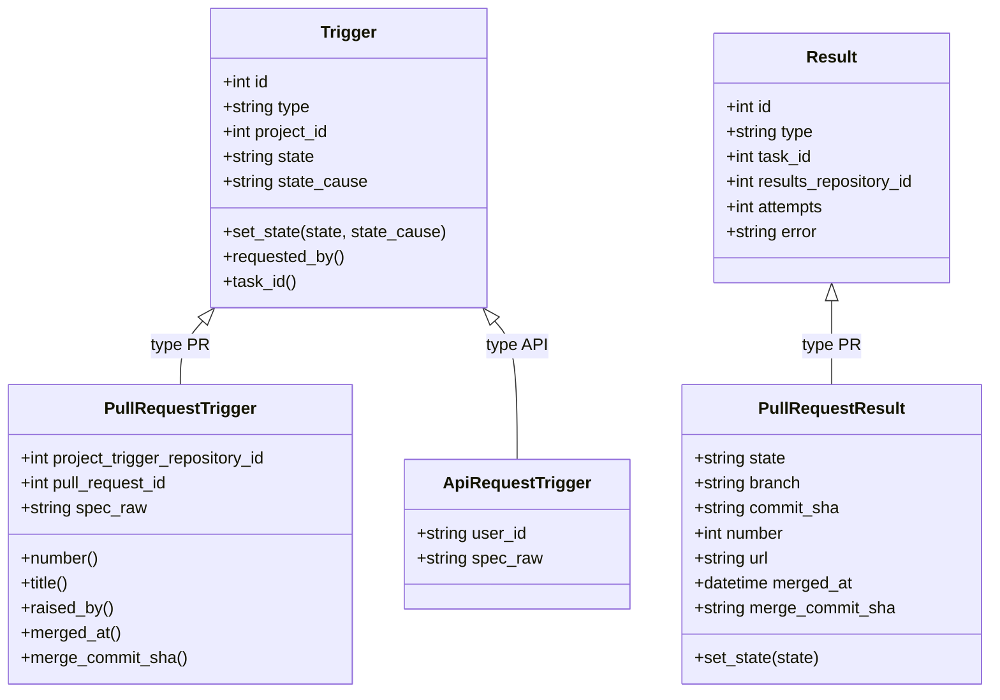
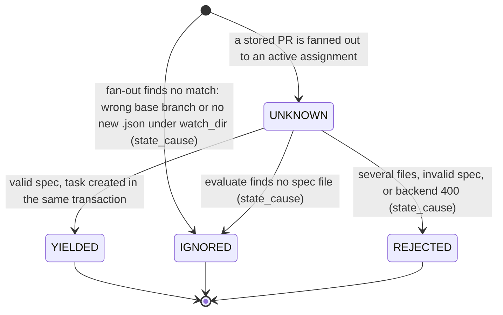
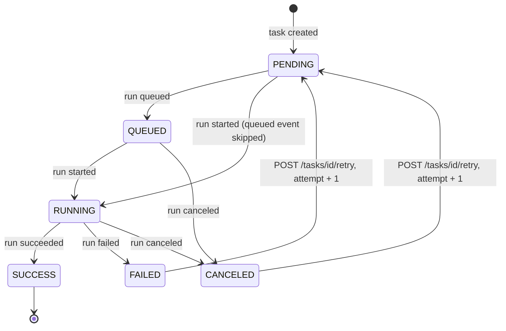
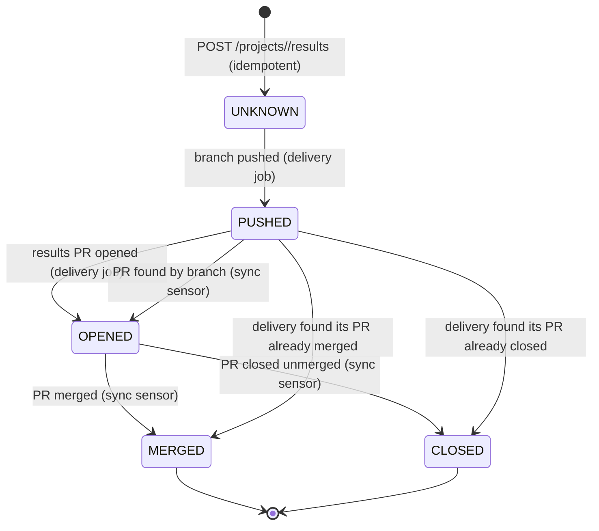

# Entities and state machines

The final backend schema (`webserver/migrations/versions/001_baseline.py`), the two inheritance trees, and the three state machines. Decisions: [0001](../../project/decisions/0001-polymorphic-triggers.md), [0008](../../project/decisions/0008-polymorphic-result-and-forward-only-state.md), [0009](../../project/decisions/0009-sync-reconciler-and-operational-rules.md), [0017](../../project/decisions/0017-task-status-written-by-run-status-sensors.md), [0019](../../project/decisions/0019-global-resources-and-shared-pull-requests.md).

Not drawn: `audit`, `registries`, `whitelisted_images`, `catalogues`, `dictionaries`, `dars` (disconnected, [0014](../../project/decisions/0014-dar-rename-and-detached-auth.md)) and `results_backends` (present in the baseline, unused by the pipeline).

## Schema

```mermaid
erDiagram
    projects {
        int id PK
        string name UK
        bool enabled
        int default_dataset_id FK "composite with project_id"
    }
    secrets {
        int id PK
        string label UK
        enum provider "K8S"
        string key UK "name in the store"
        string namespace
    }
    datasets {
        int id PK
        string name UK
        int secret_id FK
        string host
        string type
    }
    project_secrets {
        int id PK
        int project_id FK
        int secret_id FK
        bool enabled
        bool revoked
    }
    project_datasets {
        int id PK
        int project_id FK
        int dataset_id FK
        bool enabled
        bool revoked
    }
    trigger_repositories {
        int id PK
        string uri UK
        int secret_id FK
        string provider
        string api_uri
    }
    pull_requests {
        int id PK
        int trigger_repository_id FK
        int number
        string title
        string raised_by
        string base_branch
        datetime merged_at
        string merge_commit_sha
        bool files_truncated "unique with trigger_repository_id and number"
    }
    pull_request_files {
        int id PK
        int pull_request_id FK
        string path
        string status "added, modified, ..."
    }
    project_trigger_repositories {
        int id PK
        int project_id FK
        int trigger_repository_id FK
        string watch_dir
        string base_branch
        datetime initial_cursor
        int initial_cursor_number
        bool enabled
        bool revoked
    }
    pull_request_triggers {
        int trigger_id PK, FK
        int project_trigger_repository_id FK
        int pull_request_id FK "unique with the assignment"
        text spec_raw
    }
    results_repositories {
        int id PK
        string uri UK
        int secret_id FK
        string provider
        string api_uri
    }
    project_results_repositories {
        int id PK
        int project_id FK UK
        int results_repository_id FK
        string target_dir
        bool owned_by_federated_node
        bool enabled
        bool revoked
    }
    triggers {
        int id PK
        string type "PR or API"
        int project_id FK
        string state "UNKNOWN YIELDED IGNORED REJECTED"
        string state_cause
    }
    api_request_triggers {
        int trigger_id PK, FK
        string user_id
        text spec_raw
    }
    tasks {
        int id PK
        int project_id FK
        int trigger_id FK, UK "one task per trigger"
        int task_spec_id FK
        string name
        string status
        int attempt
        string requested_by
        string dagster_run_id UK
        datetime started_at
        datetime completed_at
        int exit_code
        string state_cause "why the launcher failed it"
        json params
    }
    task_specs {
        int id PK
        string image
        int dataset_id FK "optional"
        json env
    }
    results {
        int id PK
        string type "PR"
        int task_id FK
        int results_repository_id FK "the project_results_repositories row, the API shows the global repository id"
        int attempts
        string error
    }
    pull_request_results {
        int result_id PK, FK
        string state "UNKNOWN PUSHED OPENED MERGED CLOSED"
        string branch
        string commit_sha
        int number
        string url
        datetime merged_at
        string merge_commit_sha
    }

    projects ||--o{ project_datasets : "assigns"
    projects ||--o{ project_secrets : "assigns"
    secrets ||--o{ project_secrets : "is assigned via"
    projects ||--o{ project_trigger_repositories : "assigns"
    projects ||--o| project_results_repositories : "assigns one"
    projects ||--o{ triggers : "scopes"
    projects ||--o{ tasks : "scopes"
    secrets ||--o{ datasets : "credentials of"
    secrets ||--o{ trigger_repositories : "token of"
    secrets ||--o{ results_repositories : "token of"
    datasets ||--o{ project_datasets : "is assigned via"
    trigger_repositories ||--o{ pull_requests : "has PRs"
    trigger_repositories ||--o{ project_trigger_repositories : "assigned to projects"
    project_trigger_repositories ||--o{ pull_request_triggers : "yields triggers from"
    pull_requests ||--o{ pull_request_files : "changed"
    pull_requests ||--o{ pull_request_triggers : "fanned out as"
    results_repositories ||--o{ project_results_repositories : "assigned to projects"
    project_results_repositories ||--o{ results : "receives"
    triggers ||--o| pull_request_triggers : "is a"
    triggers ||--o| api_request_triggers : "is a"
    triggers ||--o| tasks : "yields"
    task_specs ||--o{ tasks : "specifies"
    datasets |o--o{ task_specs : "runs on"
    tasks ||--o{ results : "delivered as"
    results ||--o| pull_request_results : "is a"
```

Composite foreign key `(project_id, default_dataset_id)` on `projects` references `project_datasets`. Global resources (`secrets`, `trigger_repositories`, `results_repositories`, `datasets`) have no `project_id`. Pull requests are stored once per global repository (`UNIQUE(trigger_repository_id, number)`), with their changed files in `pull_request_files` and `files_truncated` set when the provider's list was cut. A `pull_request_triggers` row is unique per `(assignment, pull request)` and keeps the evaluation state; the pull request's number, title, author, merge time and commit are read through `pull_request`. A `project_trigger_repositories` row has `UNIQUE(project_id, trigger_repository_id)`, so the API addresses it by the global repository id. A `project_secrets` row links a project to a secret (`UNIQUE(project_id, secret_id)`, `enabled`, `revoked`) and never holds values. `pr_cursor` is not a column: it is the latest `merged_at` of the repository's pull requests, or of the assignment's triggers, from `initial_cursor` (set when the link is created) when it has none. An assignment is active when `enabled` and not `revoked`. A `results` row is unique per `(task_id, results_repository_id)` where `results_repository_id` is the `project_results_repositories` id.

## Inheritance trees



`state` is on the `Trigger` parent (the verdict is the same for any kind) but on the `PullRequestResult` child (the delivery lifecycle belongs to the delivery kind), see [0008](../../project/decisions/0008-polymorphic-result-and-forward-only-state.md). The trigger side is the merged pull request we watch; the result side is the pull request we open.

## Trigger state



`state_cause` is required for `IGNORED` and `REJECTED` and forbidden otherwise (check constraint and `set_state`). An `ApiRequestTrigger` is validated inside `POST /tasks`: it is recorded `REJECTED` (with the cause) when invalid, else `YIELDED` with its task, and is never `UNKNOWN` for long.

## Task status



Only the run-status sensors write the status; the backend does not enforce the order. Delivery never changes it ([0017](../../project/decisions/0017-task-status-written-by-run-status-sensors.md)).

## PullRequestResult state



Forward only: `UNKNOWN < PUSHED < OPENED < MERGED = CLOSED`. A PATCH to the same state is accepted; to an earlier state, or out of `MERGED`/`CLOSED`, is a 400. A failed delivery leaves the state and sets `error` and `attempts`.
