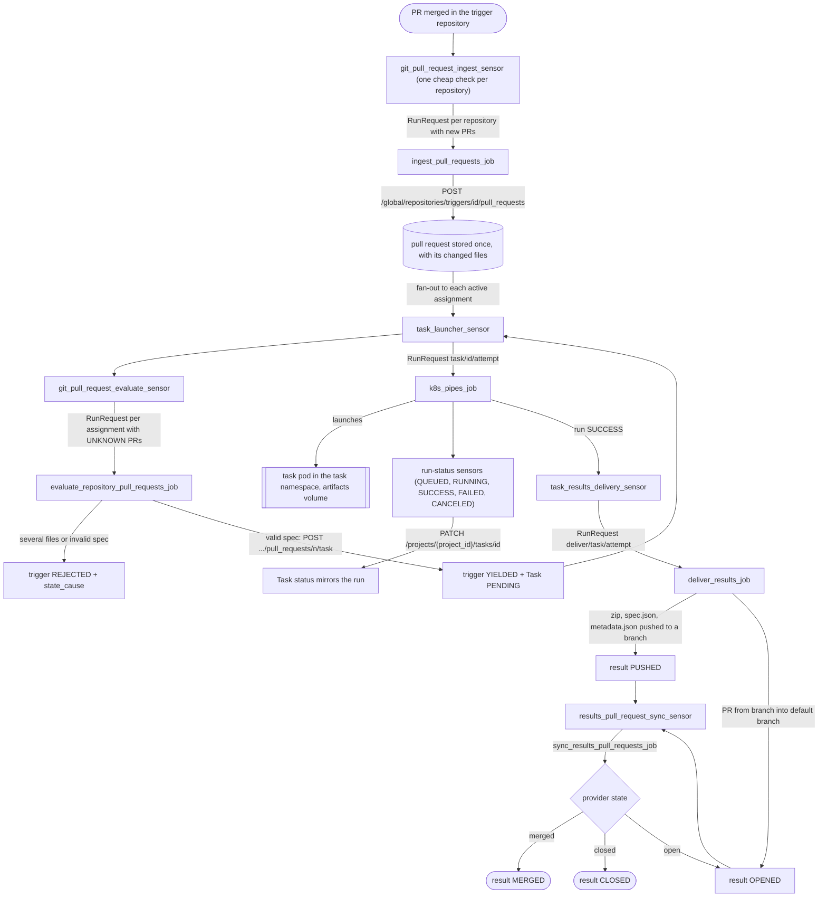
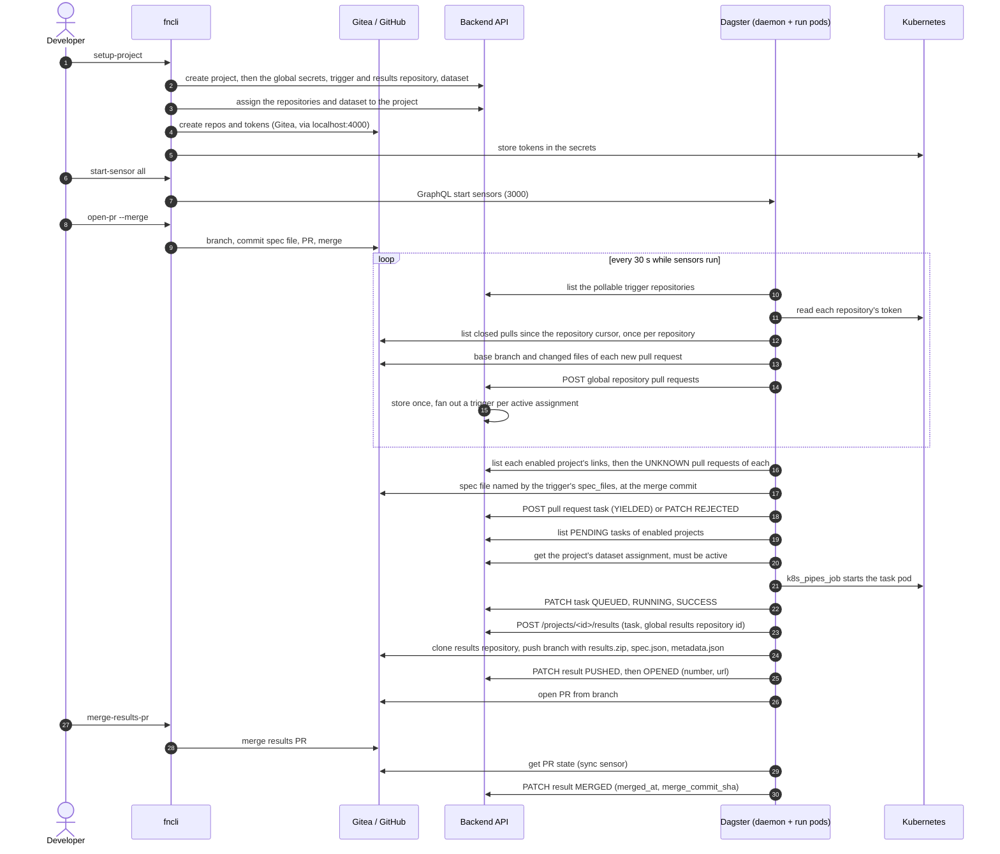
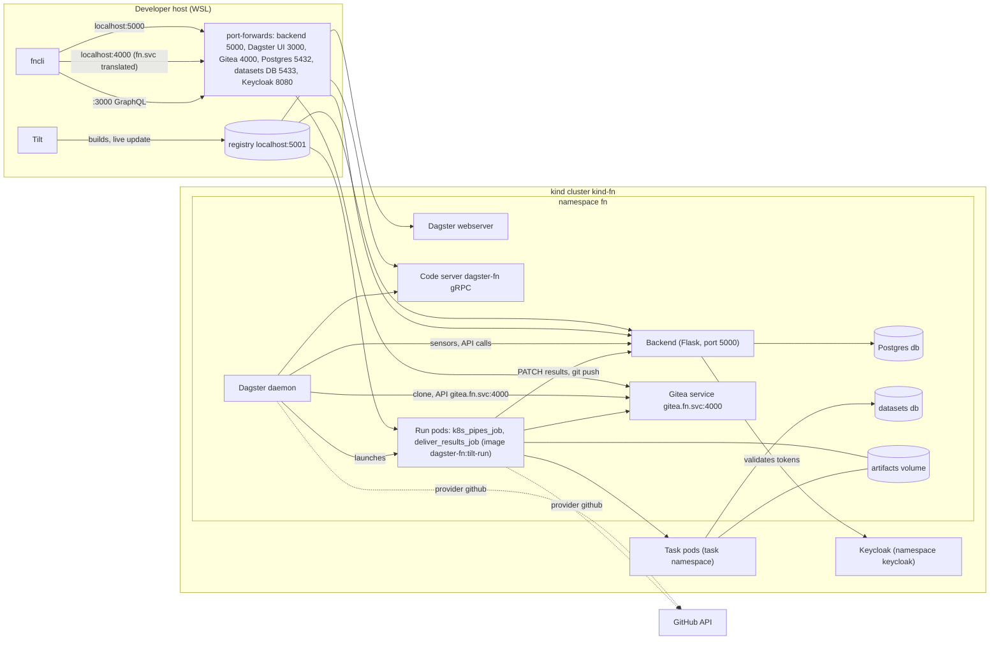

# Flows and components

How a merged pull request becomes a task, a run, and a results pull request. Decisions: [index](../../project/decisions/README.md). Entities and states: [entities.md](entities.md).

## End to end

All sensors are STOPPED by default and started by the operator ([0009](../../project/decisions/0009-sync-reconciler-and-operational-rules.md)). The delivery job only runs after a task run succeeds; a failed delivery is relaunched by `results_delivery_retry_sensor`. Run keys carry a retry slot (`DAGSTER_SENSORS_RETRY_INTERVAL_SECONDS`, default 60 s), so a failed run is retried at most once per interval; see [0009](../../project/decisions/0009-sync-reconciler-and-operational-rules.md).

## Global resources and assignments

Secrets, datasets, trigger repositories and results repositories belong to no project ([0019](../../project/decisions/0019-global-resources-and-shared-pull-requests.md)). They are created once, with `POST`, at `/global/secrets`, `/global/datasets`, `/global/repositories/triggers` and `/global/repositories/results` (admin only), then linked to a project with `PUT /projects/<id>/secrets/<label>`, `/projects/<id>/datasets/<id>`, `/projects/<id>/repositories/triggers/<id>` or `/projects/<id>/repositories/results/<id>`, where the id is the global resource's, never the link row's. `PUT` links (201 the first time, 200 after, replacing the project's settings), `PATCH` changes some, `DELETE` unlinks, and `GET` lists the collection or reads one link. The link holds what is per project: `watch_dir` and `base_branch` for a trigger repository, with a cursor set when it is linked (after the latest pull request stored, or at the link's creation when none is) that no request changes, `target_dir` for the results repository, and the `enabled` and `revoked` flags. An assignment is active when `enabled` and not `revoked`; only an active one is used. The first dataset assigned becomes the project's default, and a project has one results repository.

- There is no cross-project list. The ingest sensor reads `GET /global/repositories/triggers?pollable=true`, the enabled repositories on an enabled provider with an enabled secret (project links do not matter), each carrying the `pr_cursor` to poll from. The evaluate sensor loops over enabled projects and reads `GET /projects/<id>/repositories/triggers` for each.
- A task runs only on an active dataset assignment. The launcher fails a PENDING task, with the cause in the task's `state_cause`, when something it uses is revoked or deleted ("revoked: ..."), its configuration changed since it was created, its dataset assignment is inactive or its dataset's secret is disabled (an error while checking a task leaves it PENDING for the next tick); a manual retry (which clears it) launches it once the cause is gone. Delivery to a revoked or deleted results assignment records a `REVOKED` result (final, nothing delivered); to a disabled one it records "results link switched off", FAILED, which the retry sensor delivers once the link is active again. Neither raises.
- `revoked` is admin only and takes effect at once. The one rule left is that a project's results repository is linked only while the project is disabled (409 otherwise); a new project is disabled. `DELETE` is a soft delete (`deleted_at`): the row is gone from the API (404, not listed) and the links under it are revoked and deleted, so a task in flight gets a `REVOKED` result when it delivers. A dataset or repository with live project links is a 409 listing the projects unless `?force=true`. A deleted name is free to create again.

## Ingest and fan-out

A merged pull request is stored once per global trigger repository, whatever the number of projects watching it.

1. The ingest sensor checks each repository of `GET /global/repositories/triggers?pollable=true` once with its own secret, from the repository's `pr_cursor` (the latest stored `merged_at`; a repository with nothing stored starts at its own creation). A repository with nothing new launches nothing; one with new pull requests gets a run of `ingest_pull_requests_job` (run key: repository, cursor and the retry slot, so a failed run is retried by a later tick at most once per retry interval; a repository with a run in flight is skipped). The run reads the repository again for a fresh cursor and each pull request's base branch and changed files (a repeated path is dropped).
2. The run posts them in batches of up to 100 to `POST /global/repositories/triggers/<id>/pull_requests`. The backend stores each pull request and its files (a repeated number keeps its first facts) and answers `{created, existing}`.
3. Fan-out creates a trigger for every active assignment of the repository whose project is enabled and not revoked, from the stored data. The pull request must be after the assignment's cursor. A pull request that does not add a `.json` file under `watch_dir`, or whose base branch differs, is skipped for that assignment (logged) and gets no trigger; every other one is UNKNOWN. Only an UNKNOWN trigger can get a task (`POST .../pull_requests/<n>/task` returns 409 for a REJECTED trigger or an inactive link). A unique constraint on `(assignment, pull request)` settles races.
4. By default there is no backfill. When an assignment is enabled or un-revoked, or its project, repository or provider is switched back on, its cursor moves to now: pull requests merged while it was inactive are stored but get no trigger. A project can ask for a backfill when it is enabled (`PATCH /projects/<id>` with `{"enabled": true, "backfill": true}`, only for a disabled project): the cursors stay and the triggers of the pull requests stored while it was off are created. A change of `watch_dir` or `base_branch` is forward only.
5. Ingest does not skip a disabled project, as one poll serves every project. A disabled or revoked project gets no new triggers and its API tasks are rejected (409). The launcher leaves a disabled project's PENDING tasks until it is enabled.

## Sequence across fncli, backend, Dagster and the git host

## Components and network

The run pod (not the daemon) delivers results because it mounts the artifacts volume. Task pods run in `DAGSTER_TASK_NAMESPACE` (default: the release namespace). GitHub is reached over its API only when a repository's provider is `github`.

## Sensor and job inventory

All sensors have `default_status=STOPPED` and a 30 s minimum interval (`DAGSTER_SENSORS_MIN_INTERVAL_SECONDS`).

| Name | Kind | Watches / reads | Launches or writes | Defined in |
|---|---|---|---|---|
| `git_pull_request_ingest_sensor` | sensor | pollable trigger repositories (enabled, enabled provider and secret), provider pulls (once per repository); launches `ingest_pull_requests_job` per repository with new PRs | the job calls `POST /global/repositories/triggers/<id>/pull_requests`, which stores the pull requests and fans out triggers (UNKNOWN, none for a non-matching link) | `sensors/git/__init__.py`, `pr_ingest.py`, `ingest_job.py` |
| `git_pull_request_evaluate_sensor` | sensor | UNKNOWN pull requests of enabled projects, per active link | `evaluate_repository_pull_requests_job` per assignment, unless one is in flight | `sensors/git/pr_evaluate.py` |
| `evaluate_repository_pull_requests_job` | job (max 3 concurrent) | UNKNOWN PRs, spec at merge commit | task (YIELDED), or REJECTED with cause; op retries 3x | `sensors/git/evaluate_job.py` |
| `task_launcher_sensor` | sensor | PENDING tasks of enabled projects, their task configuration and dataset assignment | `k8s_pipes_job` run, key `task/<id>/<attempt>`, tag `trigger=task`; a task that uses something revoked, whose configuration changed, whose dataset assignment is inactive or whose dataset's secret is disabled is failed with a `state_cause` instead | `sensors/task/launcher.py` |
| `k8s_pipes_job` | job | task spec and dataset (run config) | task pod, artifacts | `definitions/jobs.py`, `pipes.py` |
| `task_queued_sensor`, `task_started_sensor`, `task_success_sensor`, `task_failure_sensor`, `task_canceled_sensor` | run-status sensors on `k8s_pipes_job` | runs tagged `trigger=task` | `PATCH /tasks/<id>` status, run id, times | `sensors/task/run_status.py` |
| `task_results_delivery_sensor` | run-status sensor (SUCCESS) on `k8s_pipes_job` | succeeded task runs | `deliver_results_job`, key `deliver/<task>/<attempt>`, tags `trigger=delivery`, `delivery_task_id` | `sensors/task/delivery.py` |
| `results_delivery_retry_sensor` | sensor | results in state FAILED at a non-final step, link active, fewer than `DAGSTER_DELIVERY_MAX_ATTEMPTS` (5) attempts | `deliver_results_job`, key `deliver-retry/<result>/<slot>`, same tags as the delivery sensor, unless one is in flight | `sensors/task/delivery.py` |
| `deliver_results_job` | job (run pod) | artifacts volume, task, the project's results repository assignment | branch, results PR, result PUSHED then OPENED | `delivery/results.py`, `git_push.py` |
| `results_pull_request_sync_sensor` | sensor | results PUSHED or OPENED (inactive assignments still resolve) | `sync_results_pull_requests_job` unless in flight | `sensors/task/pull_request_sync.py` |
| `sync_results_pull_requests_job` | job | provider PR state | result OPENED, MERGED or CLOSED, number, url, merge fields | `sensors/task/pull_request_sync.py` |
| `noop_job` | job | nothing | smoke test of the code location and run launcher | `definitions/jobs.py` |
