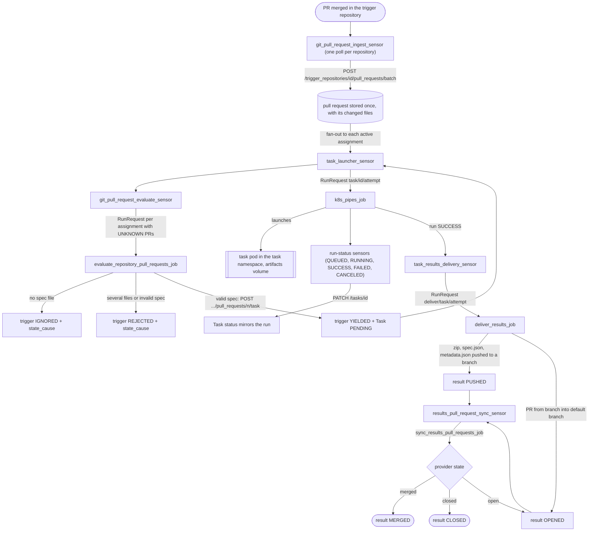
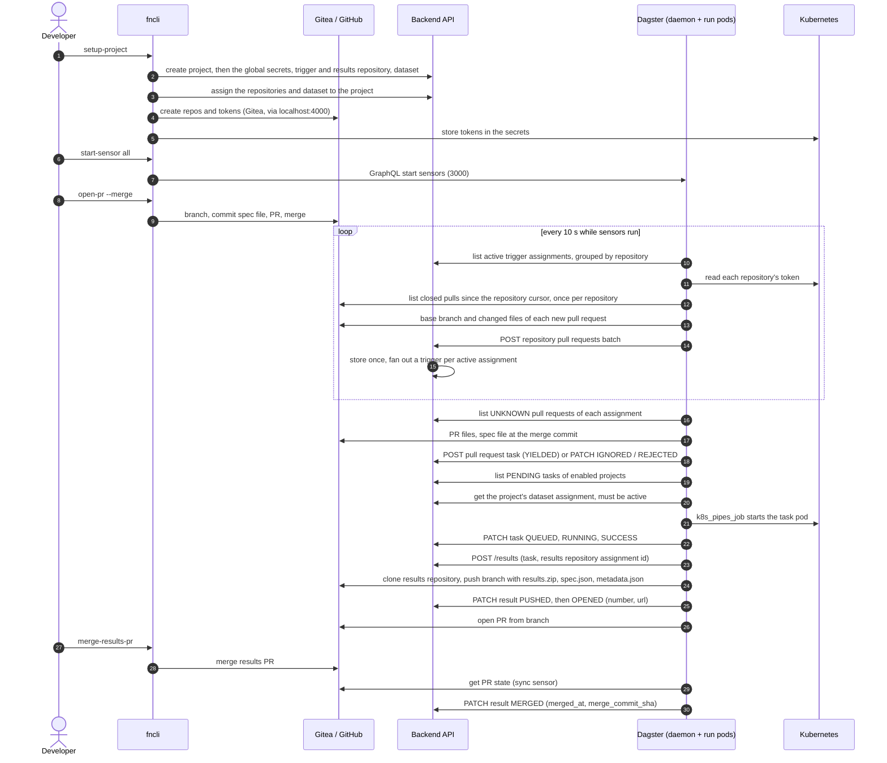
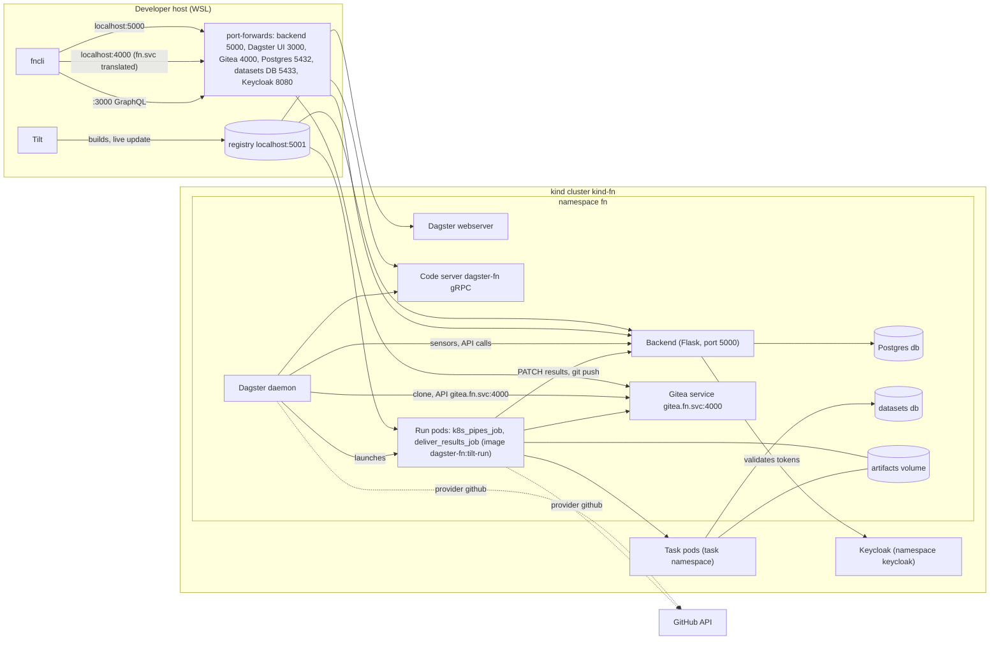

# Flows and components

How a merged pull request becomes a task, a run, and a results pull request. Decisions: [index](../../project/decisions/README.md). Entities and states: [entities.md](entities.md).

## End to end

All sensors are STOPPED by default and started by the operator ([0009](../../project/decisions/0009-sync-reconciler-and-operational-rules.md)). The delivery job only runs after a task run succeeds; a failed delivery is re-launched by hand.

## Global resources and assignments

Secrets, datasets, trigger repositories and results repositories belong to no project ([0019](../../project/decisions/0019-global-resources-and-shared-pull-requests.md)). They are created once at `/secrets`, `/datasets`, `/trigger_repositories` and `/results_repositories` (admin only), then granted to a project through an assignment at `/projects/<id>/datasets`, `/results_repositories` and `/trigger_repositories`. The assignment holds what is per project: `watch_dir`, `base_branch` and `initial_cursor` for a trigger repository, `target_dir` for the results repository, and the `enabled` and `revoked` flags. An assignment is active when `enabled` and not `revoked`; only an active one is used. The first dataset assigned becomes the project's default, and a project has one results repository.

- Dagster reads assignments, not global rows: `GET /project_trigger_repositories?active=true` lists every project's active trigger assignments in one call, and each carries its nested repository, secret and `pr_cursor`.
- A task runs only on an active dataset assignment. The launcher fails a PENDING task whose dataset assignment is inactive, with the cause in the task's `state_cause`; a manual retry (which clears it) launches it once the dataset is active again. Delivery to a revoked or disabled results assignment records "results repository access revoked", FAILED, and does not raise.
- `revoked` is admin only and takes effect at once. Changing an assignment's `enabled`, or editing or deleting a global resource, needs every project it touches locked and drained.

## Ingest, fan-out and backfill

A merged pull request is stored once per global trigger repository, whatever the number of projects watching it.

1. The ingest sensor groups the active assignments of enabled projects by repository and polls each repository once with its own secret, from the repository's `pr_cursor` (the latest stored `merged_at`; a repository with nothing stored starts at the earliest `initial_cursor` among its active assignments). It reads each pull request's base branch and changed files.
2. It posts them in batches of up to 100 to `POST /trigger_repositories/<id>/pull_requests/batch`. The backend stores each pull request and its files (a repeated number keeps its first facts) and answers `{created, existing}`.
3. Fan-out creates a trigger for every active assignment of the repository, from the stored data. The pull request must be after the assignment's cursor. A pull request that does not add a `.json` file under `watch_dir`, or whose base branch differs, becomes an IGNORED trigger with a `state_cause`; every other one is UNKNOWN. A unique constraint on `(assignment, pull request)` settles races.
4. Backfill does the same for the already stored pull requests when an assignment is created, enabled, un-revoked, or has its `initial_cursor` moved earlier. Only an active assignment is backfilled. A change of `watch_dir` or `base_branch` is forward only.
5. Ingest does not skip a locked project, as one poll serves every project. Evaluation and launch are what the lock pauses.

## Sequence across fncli, backend, Dagster and the git host

## Components and network

The run pod (not the daemon) delivers results because it mounts the artifacts volume. Task pods run in `DAGSTER_TASK_NAMESPACE` (default: the release namespace). GitHub is reached over its API only when a repository's provider is `github`.

## Sensor and job inventory

All sensors have `default_status=STOPPED` and a 10 s minimum interval.

| Name | Kind | Watches / reads | Launches or writes | Defined in |
|---|---|---|---|---|
| `git_pull_request_ingest_sensor` | sensor | active trigger assignments of enabled projects, provider pulls (once per repository) | `POST /trigger_repositories/<id>/pull_requests/batch`, which stores the pull requests and fans out triggers (UNKNOWN or IGNORED) | `sensors/git/__init__.py`, `pr_ingest.py` |
| `git_pull_request_evaluate_sensor` | sensor | UNKNOWN pull requests of enabled projects, per active assignment | `evaluate_repository_pull_requests_job` per assignment, unless one is in flight | `sensors/git/pr_evaluate.py` |
| `evaluate_repository_pull_requests_job` | job (max 3 concurrent) | UNKNOWN PRs, spec at merge commit | task (YIELDED), or IGNORED or REJECTED with cause; op retries 3x | `sensors/git/evaluate_job.py` |
| `task_launcher_sensor` | sensor | PENDING tasks of enabled projects, and their dataset assignment | `k8s_pipes_job` run, key `task/<id>/<attempt>`, tag `trigger=task`; a task whose dataset assignment is inactive is failed with a `state_cause` instead | `sensors/task/launcher.py` |
| `k8s_pipes_job` | job | task spec and dataset (run config) | task pod, artifacts | `definitions/jobs.py`, `pipes.py` |
| `task_queued_sensor`, `task_started_sensor`, `task_success_sensor`, `task_failure_sensor`, `task_canceled_sensor` | run-status sensors on `k8s_pipes_job` | runs tagged `trigger=task` | `PATCH /tasks/<id>` status, run id, times | `sensors/task/run_status.py` |
| `task_results_delivery_sensor` | run-status sensor (SUCCESS) on `k8s_pipes_job` | succeeded task runs | `deliver_results_job`, key `deliver/<task>/<attempt>`, tags `trigger=delivery`, `delivery_task_id` | `sensors/task/delivery.py` |
| `deliver_results_job` | job (run pod) | artifacts volume, task, the project's results repository assignment | branch, results PR, result PUSHED then OPENED | `delivery/results.py`, `git_push.py` |
| `results_pull_request_sync_sensor` | sensor | results PUSHED or OPENED (inactive assignments still resolve) | `sync_results_pull_requests_job` unless in flight | `sensors/task/pull_request_sync.py` |
| `sync_results_pull_requests_job` | job | provider PR state | result OPENED, MERGED or CLOSED, number, url, merge fields | `sensors/task/pull_request_sync.py` |
| `noop_job` | job | nothing | smoke test of the code location and run launcher | `definitions/jobs.py` |
