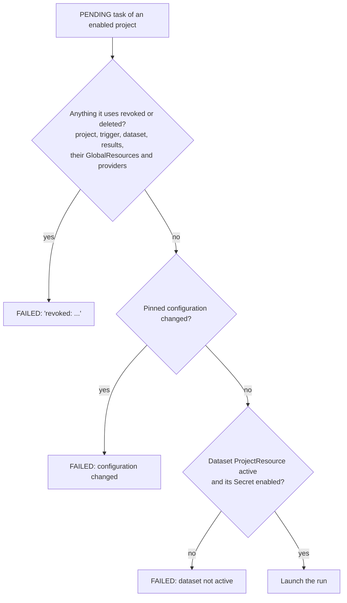
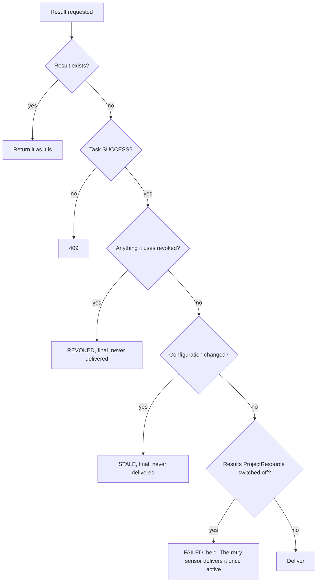

# Revoke and enabled

Two flags control what a project, a GlobalResource or a ProjectResource may do.

- A **GlobalResource** is a `Dataset`, `TriggerRepository`, `ResultsRepository` or `GitProvider`. A `Secret` is only used by GlobalResources.
- A **ProjectResource** is a project's link to a GlobalResource: `ProjectDataset`, `ProjectTriggerRepository`, `ProjectResultsRepository`. (`ProjectSecret` exists but nothing reads it.)

## The two flags

| | `enabled` | `revoked` |
|---|---|---|
| Meaning | Switched off for now | Access withdrawn |
| Effect | Stops new work. Work in flight finishes. Held work resumes when switched back on | Blocks the work for good. Results are never delivered |
| Who sets it | Anyone with the project or admin scope | Admin only (`PATCH`, field `revoked`). The Dagster System user can never set it |
| Undo | `PATCH {"enabled": true}` | `PATCH {"revoked": false}`. Does not re-enable. Results already `REVOKED` stay final |

Revoke never changes `enabled`, and un-revoke never re-enables.

## Where each flag lives

| Model | `enabled` | `revoked` | `deleted_at` |
|---|---|---|---|
| Project | yes (starts off) | yes | yes |
| Dataset, TriggerRepository, ResultsRepository, GitProvider | yes | yes | yes |
| Secret | yes | no | yes |
| ProjectDataset, ProjectTriggerRepository, ProjectResultsRepository | yes | yes | yes |

A ProjectResource is **active** when its GlobalResource is enabled and not revoked (a repository's `GitProvider` too), the ProjectResource is enabled and not revoked. A `ProjectTriggerRepository` also needs its project enabled and not revoked to accept triggers.

Soft delete sets `deleted_at` and, on every row that has the flag, `revoked`. The API treats a deleted row as gone.

## May a waiting task launch?

A project that is not enabled is not looked at, so its waiting tasks simply wait.

## May a finished task's result be delivered?

Checked in this order by `POST /projects/<pid>/results`:

## What each state does

| State | New pull requests | Waiting tasks | Running tasks | Finished results | Undo |
|---|---|---|---|---|---|
| Project disabled | Stored, no trigger | Wait | Finish | Delivered | Enable (optional `backfill`) |
| Project revoked | No trigger | Fail at launch if the project is enabled. New tasks refused (409) | Finish | `REVOKED` | Un-revoke, enable |
| TriggerRepository or provider disabled | Not polled, batch refused. Stored on catch-up, no trigger | Launch | Finish | Delivered | Enable (gap skipped) |
| TriggerRepository or provider revoked | As disabled | Fail at launch | Finish | `REVOKED` | Un-revoke (gap skipped) |
| ResultsRepository or provider disabled | n/a | Launch | Finish | `FAILED`, held and retried | Enable |
| ResultsRepository or provider revoked | n/a | Fail at launch | Finish | `REVOKED` | Un-revoke |
| Dataset disabled or revoked | Task from it refused | Fail at launch | Finish | Revoked: `REVOKED` | Enable or un-revoke, retry the task |
| ProjectResource disabled | Same as its GlobalResource, for this project only | | | | Enable |
| ProjectResource revoked | Same as revoked, for this project only | | | | Un-revoke |

"Finish" means a running task is not stopped. Its result is blocked when it is published.

## Pull request triggers

A trigger is created only when a pull request is stored and the ProjectTriggerRepository accepts triggers. Switching something back on (ProjectResource, TriggerRepository, provider, project) skips the gap: pull requests merged while it was off get no trigger. Enabling a project with `"backfill": true` creates them instead.

## Secrets

Applies once the secrets change is merged.

- Disabling a Secret disables every Dataset, TriggerRepository and ResultsRepository using it. Enabling it does not re-enable them.
- A disabled Secret's value moves to a quarantine namespace and is restored on enable. The row keeps the original namespace, so reads fail while it is moved.
- Enabling a GlobalResource whose Secret is disabled or deleted is a 409. Repoint it with `PATCH secret_label`.
- Rotating a disabled Secret is a 409.
- A Secret can be deleted only when every GlobalResource using it is disabled. `?force=true` disables them first.

## Who may do what

`revoked` needs an administrator. The Dagster System user passes the other admin scopes but is not an administrator, so it cannot revoke.

## Known limits

- A result recorded before a revoke is not re-checked: a held `FAILED` result can still be retried and delivered after a later revoke. Fix planned.
- A running task is not stopped.
- A leaked git token must also be revoked at the git host.
- A project that is both revoked and disabled keeps its waiting tasks waiting, because the launcher only reads enabled projects.
