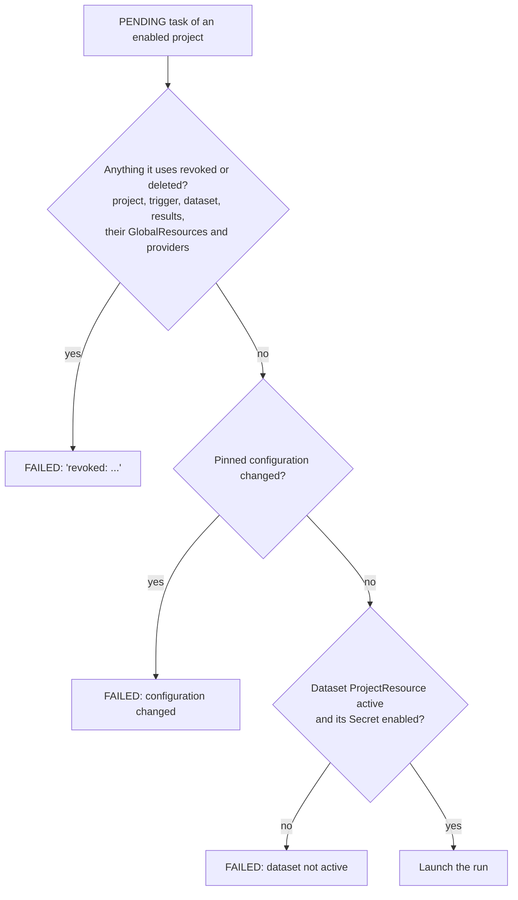
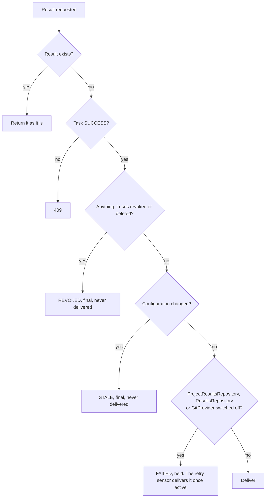
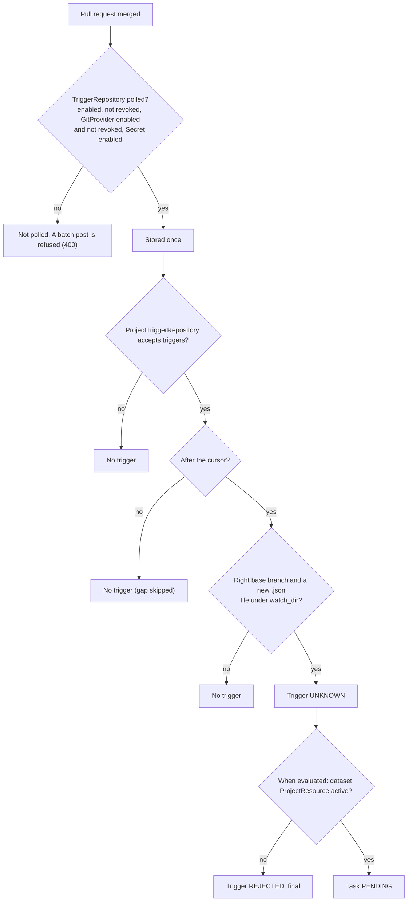

# Revoke and enabled

Two flags control what a project, a GlobalResource or a ProjectResource may do. Entities: [entities.md](entities.md). Flows: [flows.md](flows.md).

- A **GlobalResource** is a `Dataset`, `TriggerRepository`, `ResultsRepository` or `GitProvider`. A `Secret` is only used by GlobalResources.
- A **ProjectResource** is a project's link to a GlobalResource: `ProjectDataset`, `ProjectTriggerRepository`, `ProjectResultsRepository`. (`ProjectSecret` exists but nothing reads it.)

## The two flags

| | `enabled` | `revoked` |
|---|---|---|
| Meaning | Switched off for now | Access withdrawn |
| Effect | Stops new work. Work in flight finishes. Waiting work resumes when switched back on (a Dataset is the exception, see the table below) | Blocks the work. A result recorded while the revoke holds is never delivered |
| Who sets it | Project routes: the `can_admin_dataset` scope. GlobalResource routes: the admin scope | Administrators only (`PATCH`, field `revoked`; 403 otherwise). The pipeline's System user can never set it |
| Undo | `PATCH {"enabled": true}` | `PATCH {"revoked": false}` |

Revoke never changes `enabled`, and un-revoke never re-enables. A result already `REVOKED` stays final. A task that failed needs a manual retry (`POST /projects/<pid>/tasks/<id>/retry`).

## Where each flag lives

| Model | `enabled` | `revoked` | `deleted_at` |
|---|---|---|---|
| Project | yes (starts off) | yes | yes |
| Dataset, TriggerRepository, ResultsRepository, GitProvider | yes | yes | yes |
| Secret | yes | no | yes |
| ProjectDataset, ProjectTriggerRepository, ProjectResultsRepository, ProjectSecret (unused) | yes | yes | yes |

A TriggerRepository or ResultsRepository is **active** when it is enabled and not revoked and so is its GitProvider. A ProjectResource is **active** when that holds for its GlobalResource and the ProjectResource itself is enabled and not revoked. A `ProjectTriggerRepository` accepts triggers only if its project is also enabled and not revoked. GlobalResource flags are read live, so they apply to ProjectResources created later too.

"Active" is the usable-now test. The blocked test (`revoked_resources` in `webserver/app/helpers/task_config.py`) looks only at `revoked` and `deleted_at`, never at `enabled`.

## May a waiting task launch?

A project that is not enabled (or is deleted) is not looked at, so its waiting tasks simply wait. An error while checking a task leaves it PENDING for the next tick.

## May a finished task's result be delivered?

Checked in this order by `POST /projects/<pid>/results`:

## Does a new pull request get a trigger?

Only enabled projects are evaluated, and task creation from a trigger is a 409 while its ProjectTriggerRepository is inactive, so an UNKNOWN trigger waits. Switching a ProjectTriggerRepository, TriggerRepository, GitProvider or project back on (or un-revoking it) skips the gap: pull requests merged while it was off are stored but get no trigger. Enabling a disabled project with `"backfill": true` creates them instead (`backfill` is a 400 in any other case). A project has no lock: it is enabled or not.

## What each state does

| State | New pull requests | Waiting tasks | Running tasks | Finished tasks' results | Undo |
|---|---|---|---|---|---|
| Project disabled | Stored, no trigger | Wait. New API tasks: 409 | Finish | Delivered | Enable (optional `backfill`) |
| Project revoked | Stored, no trigger | Fail at launch (they wait first if the project is also disabled). New tasks are still created, then fail | Finish | `REVOKED` | Un-revoke (gap skipped), retry failed tasks |
| TriggerRepository or GitProvider disabled | Not polled, batch refused. Stored on catch-up, no trigger | Launch | Finish | Delivered | Enable (gap skipped) |
| TriggerRepository or GitProvider revoked | As disabled | Fail at launch | Finish | `REVOKED` | Un-revoke (gap skipped), retry failed tasks |
| ResultsRepository or GitProvider disabled | n/a | Launch | Finish | `FAILED`, held, retried once active | Enable |
| ResultsRepository or GitProvider revoked | n/a | Fail at launch | Finish | `REVOKED` | Un-revoke, retry failed tasks |
| Dataset disabled | Trigger made, then `REJECTED` (final) at evaluation. API task: 400 | Fail at launch | Finish | Delivered | Enable, retry failed tasks |
| Dataset revoked | As disabled | Fail at launch | Finish | `REVOKED` | Un-revoke, retry failed tasks |
| ProjectResource disabled | As its GlobalResource disabled, for this project only | | | | Enable |
| ProjectResource revoked | As its GlobalResource revoked, for this project only | | | | Un-revoke |
| Secret disabled | As the Dataset, TriggerRepository and ResultsRepository using it being disabled | | | | Enable the Secret, then each of them |

"Finish" means a running task is not stopped. Its result is checked when it is published.

## Soft delete

Deleting sets `deleted_at` and, on every row that has the flag, `revoked`, so a deleted GlobalResource or ProjectResource blocks like a revoked one. The API treats a deleted row as gone (404, not listed). Deleting a project hides it: its PENDING tasks are never launched and never failed, and `POST /projects/<pid>/results` for its tasks is a 404, so nothing is delivered. Deleting a Dataset, TriggerRepository or ResultsRepository that has ProjectResources is a 409 naming the projects, unless `?force=true`, which deletes the ProjectResources too. A GitProvider with repositories cannot be deleted.

## Secrets

Applies once the secrets change is merged. Today a Secret disable already disables the Datasets, TriggerRepositories and ResultsRepositories using it, the launcher fails a task whose Dataset's Secret is disabled, and a disabled Secret is not polled.

- Enabling a Secret does not re-enable them. It is two steps.
- A disabled Secret's value moves to a quarantine namespace and is restored on enable. The row keeps the original namespace, so reads fail while it is moved.
- Enabling a Dataset, TriggerRepository or ResultsRepository whose Secret is disabled or deleted is a 409. Repoint it with `PATCH secret_label` (naming a disabled Secret there is a 400).
- Rotating a disabled Secret is a 409, unless the same request enables it.
- Deleting a Secret is a 409 while an enabled GlobalResource uses it. `?force=true` disables them first. Disabled ones may keep pointing at it until repointed.

## Who may do what

`revoked` needs the Administrator role, on every route that has the flag (403 otherwise). The pipeline's System user is not an administrator, so it can never revoke or un-revoke. Other global write routes need the admin scope. Today a System token skips every scope check; once the access change is merged it is allowed only on the routes the pipeline and the CLI call.

## Known limits

- A result recorded before a revoke is not re-checked. A `FAILED` result that is not final is still retried, so after a project, Dataset or TriggerRepository revoke it can still be delivered. After a revoke on the results side it is paused, and resumes on un-revoke.
- A running task is not stopped. A push already in progress may still complete.
- A leaked git token must also be revoked at the git host.
- A revoked project that is still enabled is not refused new tasks. They are created and then fail at launch.
- A project that is both revoked and disabled keeps its waiting tasks waiting, because the launcher only reads enabled projects. They fail once it is enabled.
- `ProjectSecret` has the flags but nothing reads them.
- `openapi.json` is not regenerated for the `revoked` fields.
