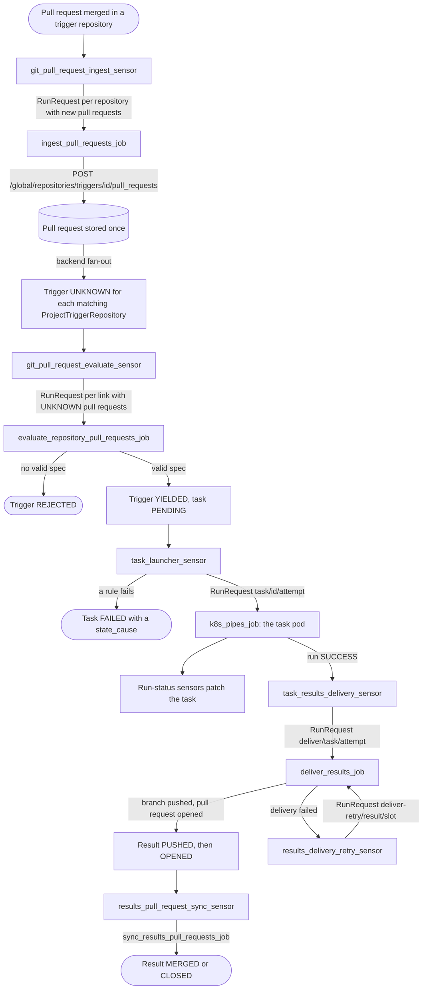

# Sensors

One document per sensor. Wider picture: [flows.md](../flows.md). Entities and states: [entities.md](../entities.md). Decisions: [0023](../../../project/decisions/0023-dagster-pipeline-ops-sensors-and-retries.md) (the pipeline), [0021](../../../project/decisions/0021-pull-requests-stored-once-fan-out-and-cursors.md) (pull requests and cursors), [0022](../../../project/decisions/0022-state-transition-tables.md) (the 409s), [0009](../../../project/decisions/0009-sync-reconciler-and-operational-rules.md) (run keys).

## What a sensor is here

A Dagster sensor is a function the Dagster daemon calls on a timer (a tick). It reads the backend, sometimes the git provider, and then asks Dagster to launch a run of a job (a run request), patches the backend, or skips. A run-status sensor does not poll a list: each tick it reacts to the runs that reached its status.

A sensor keeps no state of its own. The state is in the backend (pull requests, tasks, results) and in Dagster (runs and run keys).

All sensors are registered by `dagster/app/definitions/__init__.py`, which takes `SENSORS` and `JOBS` from `sensors/__init__.py`, which joins `sensors/git/__init__.py` and `sensors/task/__init__.py`. That is 11 sensors and 4 jobs of their own, plus `k8s_pipes_job`.

| Sensor | Kind | Launches or writes | Document |
|---|---|---|---|
| `git_pull_request_ingest_sensor` | interval | `ingest_pull_requests_job` | [pr-ingest](pr-ingest.md) |
| `git_pull_request_evaluate_sensor` | interval | `evaluate_repository_pull_requests_job` | [pr-evaluate](pr-evaluate.md) |
| `task_launcher_sensor` | interval | `k8s_pipes_job`, or fails a task | [task-launcher](task-launcher.md) |
| `task_queued_sensor`, `task_started_sensor`, `task_success_sensor`, `task_failure_sensor`, `task_canceled_sensor` | run status | patches the task's status | [run-status](run-status.md) |
| `task_results_delivery_sensor` | run status (`SUCCESS`) | `deliver_results_job` | [run-status](run-status.md) (the job: [results-delivery](results-delivery.md)) |
| `results_delivery_retry_sensor` | interval | `deliver_results_job` | [results-delivery](results-delivery.md) |
| `results_pull_request_sync_sensor` | interval | `sync_results_pull_requests_job` | [results-pr-sync](results-pr-sync.md) |

Shared helpers (`BaseSensor`, `run_key`, `run_in_flight`, the launching tick loop): [base](base.md).

## From a merged pull request to delivered results

## Settings every sensor shares

Read once, when the code location loads (`dagster/app/config.py`).

| Setting | Default | Effect |
|---|---|---|
| `DAGSTER_SENSORS_INITIAL_STATUS` | `STOPPED` | Status of a sensor Dagster has not seen before. A sensor started or stopped since keeps its status. |
| `DAGSTER_SENSORS_MIN_INTERVAL_SECONDS` | 30 | Minimum seconds between ticks, for every sensor. |
| `DAGSTER_SENSORS_RETRY_INTERVAL_SECONDS` | 60 | Length of the run key slot: a failed run is retried at most once per interval. See [base](base.md). |
| `DAGSTER_DELIVERY_MAX_ATTEMPTS` | 5 | Failed delivery attempts after which the retry sensor gives up. |

## `enabled` and `revoked`

A GlobalResource (a `Dataset`, `TriggerRepository`, `ResultsRepository` or `GitProvider`) and a ProjectResource (a project's link to one: `ProjectDataset`, `ProjectTriggerRepository`, `ProjectResultsRepository`) each have two flags. A project has them too.

- `enabled`: switched on or off. A person does it.
- `revoked`: access withdrawn. Only an admin sets it, and it takes effect at once. It never changes `enabled`, so a re-grant restores the old state.
- Active: enabled and not revoked, at the link, the GlobalResource and (for repositories) the GitProvider.
- A deleted link or GlobalResource counts as revoked.

| Sensor | Projects it looks at | What it leaves out |
|---|---|---|
| ingest | none | a TriggerRepository or GitProvider that is disabled or revoked, or a disabled secret, is not polled |
| evaluate | enabled projects (a revoked one is still listed) | links that are not active |
| task launcher | enabled projects (a revoked one is still listed) | it fails a task that uses anything revoked, whose configuration changed, or whose dataset is not active or has a disabled secret |
| run-status sensors | any | nothing: they follow runs |
| delivery retry | all projects | results whose link is not active, and results at a final step |
| results pull request sync | all projects | nothing |
