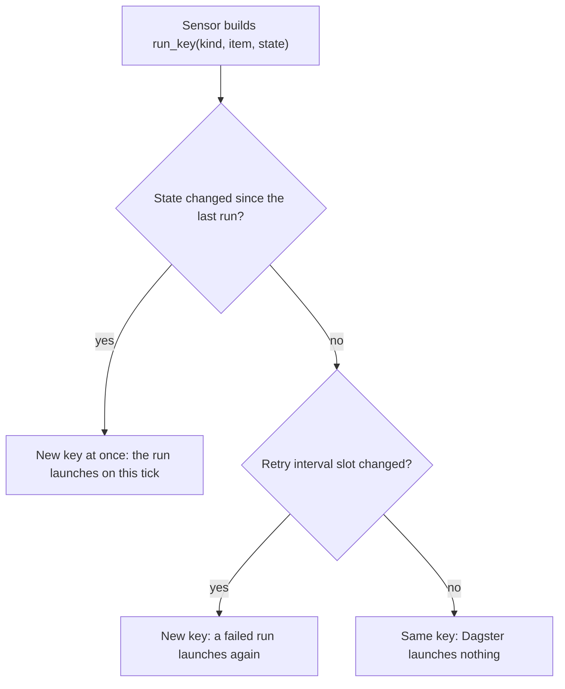
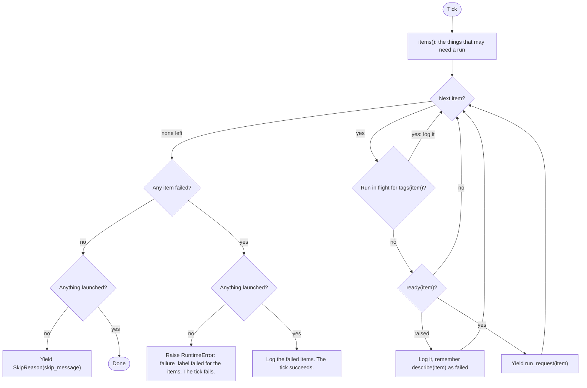

# Shared helpers

Code: `dagster/app/definitions/sensors/base.py`. Index: [README](README.md).

## Purpose

Three small things every sensor leans on: a run key that allows a timed retry (`run_key`), a check for a run already queued or started (`run_in_flight`), and base classes. `LaunchingSensor` is the tick loop shared by the sensors that launch one run per item.

## What is in it

| Name | What it is | Used by |
|---|---|---|
| `BaseSensor` | Abstract class. Keeps `context` and `log`; `setup()` does nothing; `__call__` is abstract. | every class-based sensor |
| `LaunchingSensor` | `BaseSensor` that launches one run per ready item (below). | ingest, evaluate, delivery retry |
| `run_key(kind, item_id, state)` | Builds the run key `kind/item_id/state/slot`. | ingest, evaluate, delivery retry, results pull request sync |
| `run_in_flight(context, job, tags)` | True when a run of the job with these tags is queued or started. | `LaunchingSensor`, results pull request sync |
| `IN_FLIGHT` | The statuses `run_in_flight` looks for: `NOT_STARTED`, `QUEUED`, `STARTING`, `STARTED`. | `run_in_flight` |

`GitSensor` (`sensors/git/base.py`) adds the backend client and the git client factory. The ingest and evaluate sensors extend `LaunchingSensor` and `GitSensor`. The delivery retry sensor extends `LaunchingSensor` only. The task launcher and the task status mirror extend `BaseSensor` directly.

## run_key

`kind/item_id/state/slot`. A part that is `None` is left out (a state of `0` is kept). The slot is `int(now / DAGSTER_SENSORS_RETRY_INTERVAL_SECONDS)`, 60 s by default.

Dagster remembers the run keys of a sensor for good: a key that launched once never launches again, even when its run failed. So a retry needs a new key.

| Sensor | Run key | New key when |
|---|---|---|
| ingest | `ingest/repository id/pr_cursor/slot` | new merged pull requests move the cursor; or the next slot |
| evaluate | `evaluate/project id/repository id/newest UNKNOWN PR number/slot` | a newer UNKNOWN pull request arrives; or the next slot |
| delivery retry | `deliver-retry/result id/slot` | the next slot |
| results pull request sync | `sync-results-prs/slot` | the next slot |
| task launcher (no helper) | `task/task id/attempt` | a manual retry bumps the attempt |
| delivery on success (no helper) | `deliver/task id/attempt` | a manual retry bumps the attempt |

A key does not stop a run that is still going: that is `run_in_flight`'s job. The last two keys have no slot on purpose: their run is the only run of that attempt.

## run_in_flight

Asks the Dagster instance for one run of the job whose tags match and whose status is in `IN_FLIGHT`. The tags name the item, so one item cannot have two runs at once. The delivery runs of one task share the tags `trigger=delivery` and `delivery_task_id`, so the retry sensor also skips a delivery that the success sensor launched.

## LaunchingSensor

A subclass sets `job`, `failure_label` and `skip_message` and says what `items()` are, how to `describe()` one, its `tags()`, whether it is `ready()` (may call the backend or the git provider) and its `run_request()`.

- One broken item must not starve the others, so the check of each item is inside a `try`.
- Dagster drops what a failing tick yielded, so the tick only fails when nothing launched. The failed items are retried on the next tick: no run was created, so their run key is unused.
- `items()` is outside the `try`: if listing fails, the whole tick fails and the next tick starts again.
