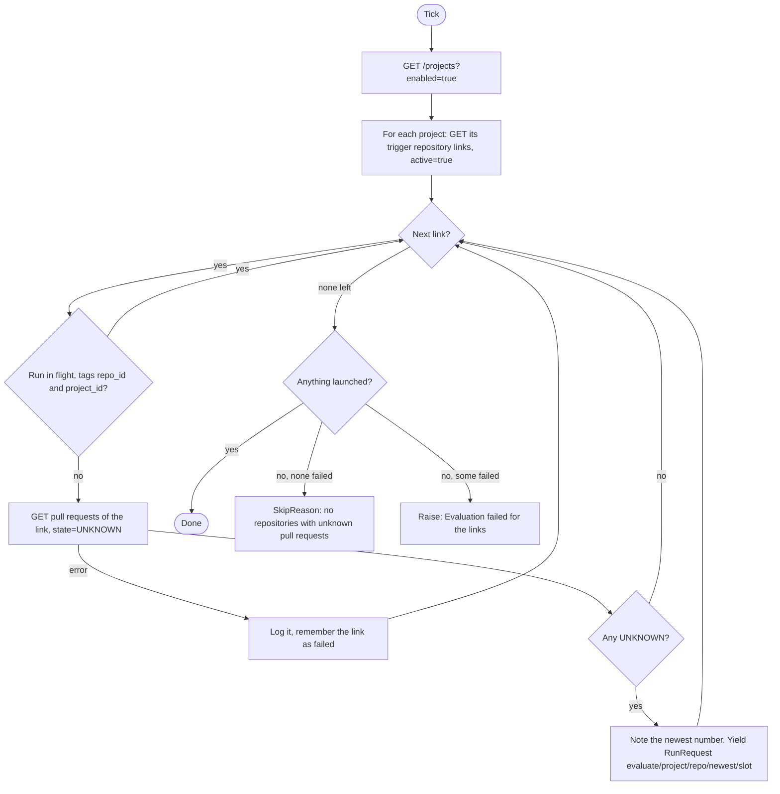
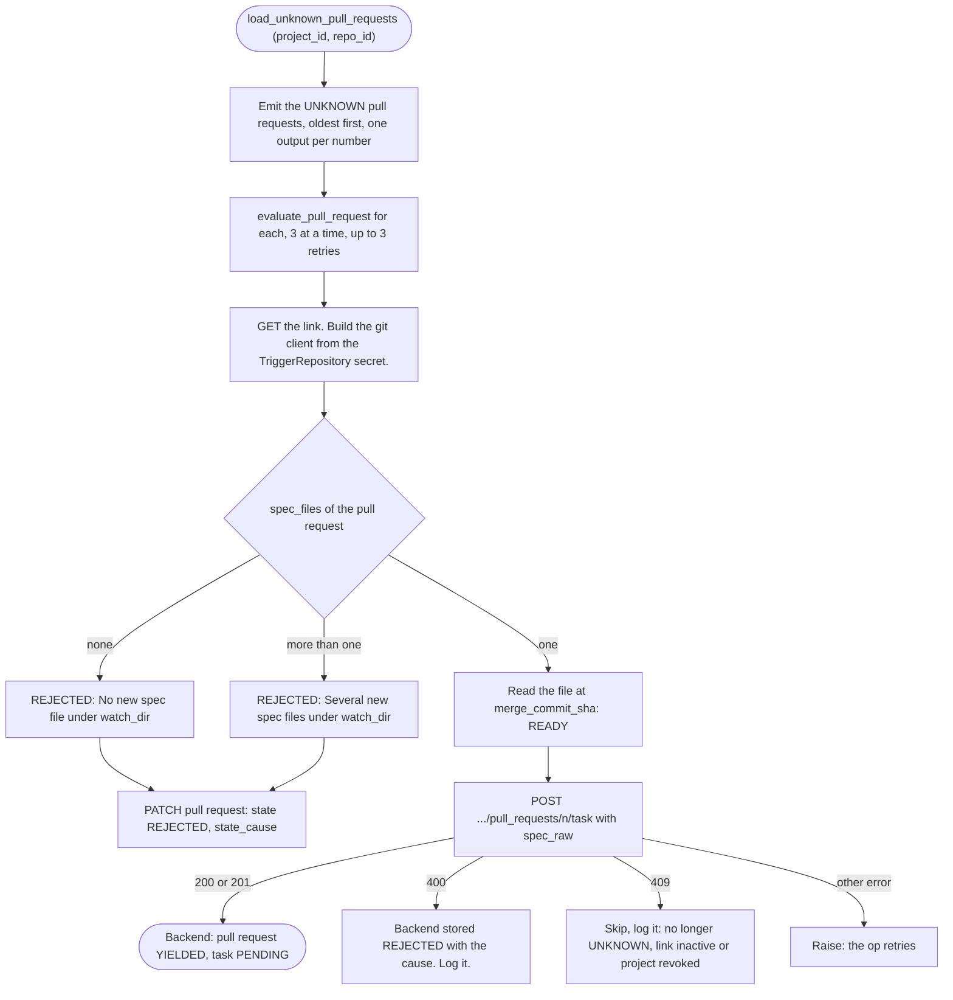

# Pull request evaluate

Sensor `git_pull_request_evaluate_sensor` (`PullRequestEvaluateSensor`) and its job `evaluate_repository_pull_requests_job`. Code: `dagster/app/definitions/sensors/git/pr_evaluate.py`, `evaluate_job.py`, `pr_parser.py`. Index: [README](README.md).

## 1. Purpose

Turns the UNKNOWN pull requests of a project into a task (the pull request becomes YIELDED) or a rejection (REJECTED, with a cause). The sensor finds the links that have UNKNOWN pull requests; the job reads each spec file from the git provider and hands it to the backend.

## 2. When it runs

- Interval sensor, at most once per `DAGSTER_SENSORS_MIN_INTERVAL_SECONDS` (default 30 s).
- Starts `STOPPED` (`DAGSTER_SENSORS_INITIAL_STATUS`).
- Run key slot: `DAGSTER_SENSORS_RETRY_INTERVAL_SECONDS` (default 60 s). See [base](base.md).

## 3. What it reads

| Who | Call | Filter or note |
|---|---|---|
| sensor | `GET /projects` | `enabled=true`, all pages of 100. A revoked project is still listed: revoking does not change `enabled`. |
| sensor | `GET /projects/{id}/repositories/triggers` | `active=true`: the ProjectTriggerRepository is enabled and not revoked, and its TriggerRepository and GitProvider are enabled and not revoked. |
| sensor | `GET /projects/{id}/repositories/triggers/{repo}/pull_requests` | `state=UNKNOWN`, all pages. Only to know whether there are any and the newest number. |
| job | same pull requests call | `state=UNKNOWN`, to load the pull requests. |
| job | `GET /projects/{id}/repositories/triggers/{repo}` | The link, with its `watch_dir` and TriggerRepository. |
| job | git provider: the spec file | Read at the pull request's `merge_commit_sha`, with the TriggerRepository's secret. |

It considers enabled projects and their active ProjectTriggerRepositories. The GlobalResource TriggerRepository (with its GitProvider and secret) is read only by the job, through the link. The sensor does not call the git provider. The backend names the spec files of each pull request in `spec_files` (files the pull request adds, ending in `.json`, under `watch_dir`).

## 4. Flow chart

Sensor:

Job:

## 5. What it produces

| Output | Value |
|---|---|
| Run request | job `evaluate_repository_pull_requests_job`, one per link with UNKNOWN pull requests |
| Run key | `evaluate/<project id>/<repository id>/<newest UNKNOWN number>/<slot>` |
| Tags | `repo_id`, `project_id` |
| Run config | `load_unknown_pull_requests: {project_id, repo_id}` |
| Skip | `SkipReason("No repositories with unknown pull requests to evaluate.")` |
| Backend writes (job) | `POST .../pull_requests/{n}/task` with the raw spec file (the backend keeps it, validates it, creates the task and marks the pull request YIELDED, or marks it REJECTED); `PATCH .../pull_requests/{n}` with `state` and `state_cause` for the two rejections found here |

The job runs up to 3 pull requests at once, to stay under the git provider's rate limit.

## 6. Retries and failure handling

- A bad spec is an outcome, not an error. REJECTED is final and never re-evaluated.
- A git or backend failure raises. The op retries 3 times with a growing delay (5 s, then doubling). After that the run fails and the pull request stays UNKNOWN.
- A UNKNOWN pull request left behind keeps its link in the sensor's list. The next slot gives a new run key (the newest number is the same, the slot is not), so the link is evaluated again.
- A 409 (the move is refused, [0005](../../../project/decisions/0005-state-transition-tables.md); the rule is skip, [0014](../../../project/decisions/0014-dagster-pipeline-ops-sensors-and-retries.md)) leaves the pull request as it is. It is logged, not retried by the op. If the cause is still there (see section 7) the link is relaunched every retry interval.
- A failing check of one link is logged and the others still launch. The tick fails only when nothing launched. A failure while listing projects or links fails the tick.
- A link with a run queued or started is skipped.

## 7. How `enabled` and `revoked` change what it does

| State | Effect |
|---|---|
| Project disabled | Not listed: its links are not looked at. Its UNKNOWN pull requests wait until it is enabled. |
| Project revoked (still enabled) | Still listed and still launched. A pull request without exactly one spec file is still marked REJECTED. A valid one gets a 409 from the backend (the project is revoked): it stays UNKNOWN and is relaunched every retry interval until the project is restored. The backend also creates no new triggers for it. |
| ProjectTriggerRepository disabled or revoked | Not in the `active=true` list: skipped. A run already started gets a 409 for it, and skips. |
| TriggerRepository or GitProvider disabled or revoked | Same: the link is not active. |
| Secret disabled | Not checked by the sensor. The job fails when it reads the token (`PermissionError`), after its retries. The next slot tries again. |
