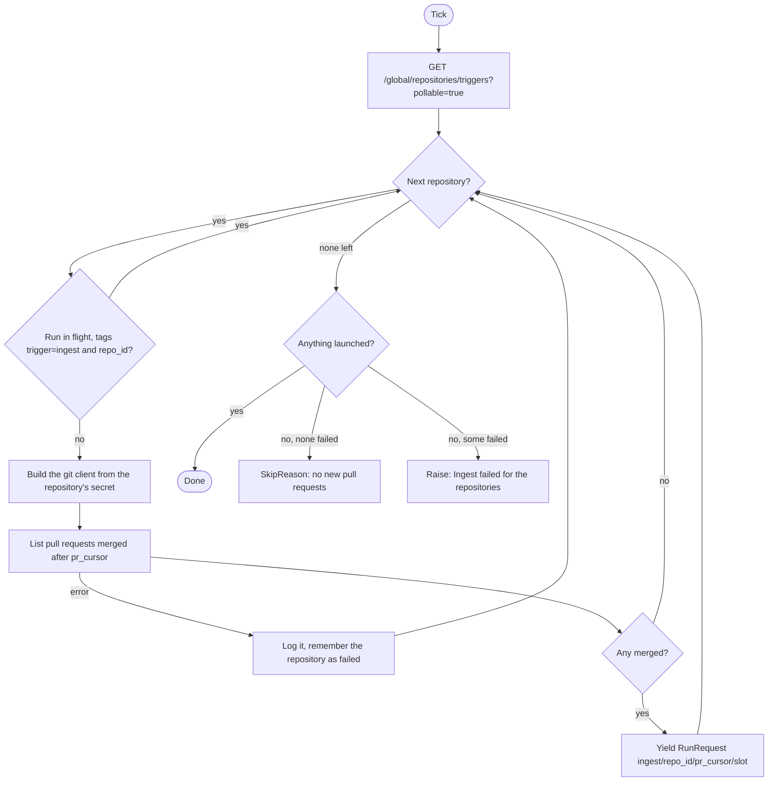
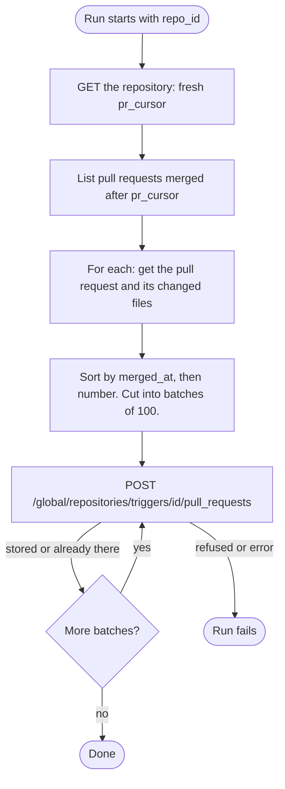

# Pull request ingest

Sensor `git_pull_request_ingest_sensor` (`PullRequestIngestSensor`) and its job `ingest_pull_requests_job`. Code: `dagster/app/definitions/sensors/git/pr_ingest.py`, `ingest_job.py`, `__init__.py`. Index: [README](README.md). Decisions: [0014](../../../project/decisions/0014-dagster-pipeline-ops-sensors-and-retries.md), and [0011](../../../project/decisions/0011-pull-requests-stored-once-fan-out-and-cursors.md) for what the backend does with the POST.

## 1. Purpose

Finds merged pull requests in each trigger repository and stores them once, for every project that watches it. The sensor only checks; the job reads the pull requests and posts them to the backend.

## 2. When it runs

- Interval sensor, at most once per `DAGSTER_SENSORS_MIN_INTERVAL_SECONDS` (default 30 s).
- Starts `STOPPED` (`DAGSTER_SENSORS_INITIAL_STATUS`); an operator starts it.
- Run key slot: `DAGSTER_SENSORS_RETRY_INTERVAL_SECONDS` (default 60 s). See [base](base.md).

## 3. What it reads

| Who | Call | Filter or note |
|---|---|---|
| sensor | `GET /global/repositories/triggers` | `pollable=true`: the TriggerRepository is enabled and not revoked, its GitProvider is enabled and not revoked, its secret is enabled. Project resources are ignored. Each item carries `pr_cursor`. |
| sensor | git provider: pull requests merged after `pr_cursor` | One check per repository, with the repository's own secret. No base branch filter: each pull request carries its base branch and the backend matches it per project resource. |
| job | `GET /global/repositories/triggers/{id}` | A fresh `pr_cursor`. |
| job | git provider: merged pull requests, each pull request, its changed files | A repeated file path is dropped. |

It considers GlobalResources only: the TriggerRepository, its GitProvider and its secret. It looks at no project and no ProjectTriggerRepository; the backend does that when it fans out.

`pr_cursor` is the latest stored `merged_at`, or the repository's creation time when nothing is stored. It moves only when a batch is stored.

## 4. Flow chart

Sensor:

Job (`ingest_pull_requests`):

What the backend does with each POST: it stores each pull request once (a stored number is left as it is), then creates one UNKNOWN trigger per ProjectTriggerRepository that accepts triggers and matches the pull request. A project resource matches when the pull request is merged into its `base_branch`, is after the project resource's cursor, and adds a `.json` file under its `watch_dir`. Other project resources get no trigger (logged by the backend).

## 5. What it produces

| Output | Value |
|---|---|
| Run request | job `ingest_pull_requests_job`, one per repository with new merged pull requests |
| Run key | `ingest/<repository id>/<pr_cursor>/<slot>` |
| Tags | `trigger=ingest`, `repo_id=<repository id>` (never `trigger=task`: the status mirror acts on that) |
| Run config | `ingest_pull_requests: {repo_id}` |
| Skip | `SkipReason("No new pull requests found for repositories.")` |
| Backend writes (job) | `POST /global/repositories/triggers/{id}/pull_requests`, at most 100 pull requests per call, oldest first |

The sensor patches nothing. Triggers are created by the backend inside the POST.

## 6. Retries and failure handling

- A failing check of one repository (provider error, unreadable secret) is logged. The others still launch. The tick fails only when nothing launched. No run was created, so the next tick checks it again.
- A repository with a run queued or started is skipped without calling the provider.
- A failing job (provider or backend error, a batch refused) fails the run. The cursor only moves once a batch is stored, so a batch never leaves an older pull request behind it. The next slot gives a new run key and the repository is polled again from the cursor.
- Posting again is safe: stored numbers are reported as `existing` and left alone.
- Nothing here is final. A repository that stays pollable is polled forever.

## 7. How `enabled` and `revoked` change what it does

| State | Effect |
|---|---|
| TriggerRepository disabled or revoked | Not in the pollable list: not polled. No error. |
| GitProvider disabled or revoked | Same. |
| Secret disabled | Same (the backend filter checks it). |
| ProjectTriggerRepository disabled or revoked | The poll goes on. The backend creates no trigger for that project resource. |
| Project disabled or revoked | The poll goes on (one poll serves every project). The backend creates no trigger for its project resources. |

The pull requests are still stored while a project resource or project is switched off. When a project resource is enabled or un-revoked, or its project, repository or provider is switched back on, the backend moves the project resource's cursor to now: what was merged meanwhile gets no trigger. Enabling a disabled project with `backfill: true` creates those triggers instead.
