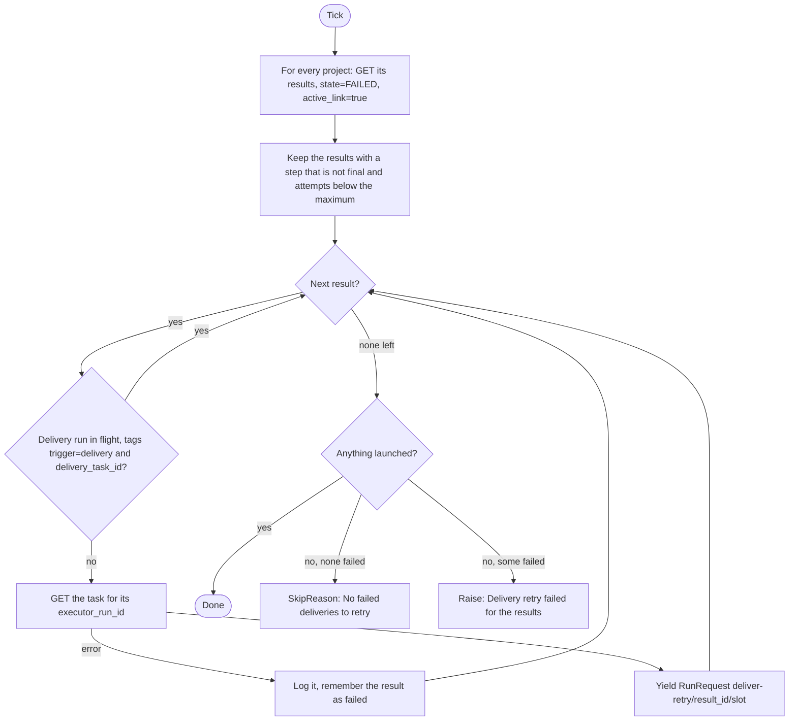
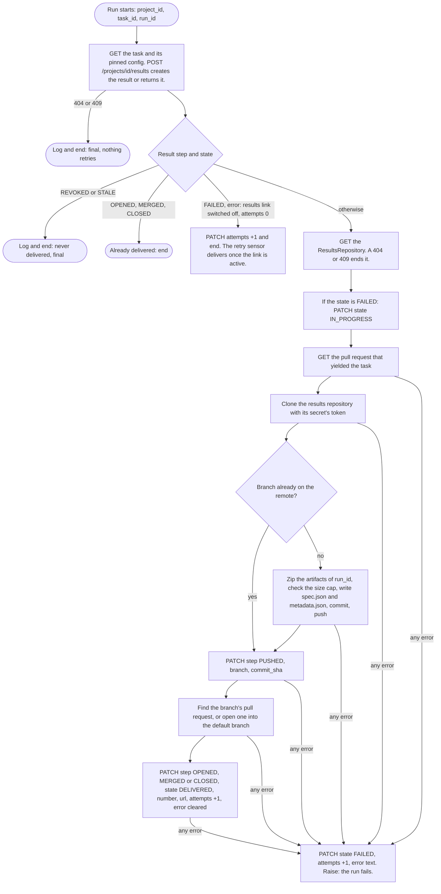

# Results delivery retry

Sensor `results_delivery_retry_sensor` (`ResultsDeliveryRetrySensor`) and the job it shares with the success sensor, `deliver_results_job`. Code: `dagster/app/definitions/sensors/task/delivery.py`, `dagster/app/delivery/results.py`, `git_push.py`. Index: [README](README.md).

`deliver_results_job` has two launchers. `task_results_delivery_sensor` starts the first attempt when a task run succeeds (see [run-status](run-status.md)). This sensor starts the later attempts.

## 1. Purpose

Relaunches `deliver_results_job` for each result whose delivery failed and may still work. The job zips the task's artifacts, pushes them to a branch of the project's results repository and opens a pull request into its default branch.

## 2. When it runs

- Interval sensor, at most once per `DAGSTER_SENSORS_MIN_INTERVAL_SECONDS` (default 30 s).
- Starts `STOPPED` (`DAGSTER_SENSORS_INITIAL_STATUS`).
- Run key slot: `DAGSTER_SENSORS_RETRY_INTERVAL_SECONDS` (default 60 s).
- Gives up after `DAGSTER_DELIVERY_MAX_ATTEMPTS` attempts (default 5).

## 3. What it reads

| Who | Call | Filter or note |
|---|---|---|
| sensor | `GET /projects` | All projects, disabled and revoked ones too. |
| sensor | `GET /projects/{id}/results` | `state=FAILED`, `active_link=true` (the ProjectResultsRepository is enabled and not revoked, and its ResultsRepository and GitProvider are enabled and not revoked). The sensor then keeps results whose `step` is not final (`OPENED`, `MERGED`, `CLOSED`, `REVOKED`, `STALE`) and whose `attempts` is below the maximum. |
| sensor | `GET /projects/{id}/tasks/{task}` | The task's `executor_run_id`: the folder of its artifacts. |
| job | task, its pinned config, `POST /projects/{id}/results`, `GET /global/repositories/results/{id}`, the task's trigger | The pinned `config_snapshot` gives the results repository and `target_dir`, because the project's link may be deleted by now. |
| job | git provider | Clone, push, find or open the pull request, with the ResultsRepository's secret. |

It considers every project, the ProjectResultsRepository that its results were delivered to (only active ones are retried), and the GlobalResource ResultsRepository through it. It does not look at the project's `enabled` or `revoked`.

## 4. Flow chart

Sensor:

Job (`deliver_results`, class `ResultsDelivery`):

## 5. What it produces

| Output | Value |
|---|---|
| Run request | job `deliver_results_job`, one per failed result that can be retried |
| Run key | `deliver-retry/<result id>/<slot>` (no attempt count: a failing delivery is retried at most once per retry interval) |
| Tags | `trigger=delivery`, `delivery_task_id=<task id>` (never `trigger=task`: the status mirror ignores it) |
| Run config | `deliver_results: {project_id, task_id, run_id}`, with the task's `executor_run_id` as `run_id` |
| Skip | `SkipReason("No failed deliveries to retry.")` |

What the job writes: the result (`POST /projects/{id}/results`, then `PATCH` per step) and a branch `<target_dir>/<trigger repository name>/<pull request number>/<task id>-<first 7 characters of the merge sha>` holding `results.zip`, `spec.json` and `metadata.json`, and a pull request from it into the default branch. The zip is capped by `RESULTS_MAX_ZIP_BYTES` (10 MiB by default). The job never changes the task's status.

## 6. Retries and failure handling

- The sensor relaunches a FAILED result whose step is not final, whose link is active and whose `attempts` is below the maximum. Every try, failed or not, adds one to `attempts`.
- The job resumes. A branch already on the remote is not pushed again, its pull request is looked up before one is opened, and a pull request merged or closed meanwhile is recorded as such.
- After the maximum the result stays FAILED. It is retried only by hand: reset `attempts` with a PATCH, or run `deliver_results_job` again.
- A failure inside the job is written on the result (`FAILED`, the error text, one more attempt, the step left where it was) and raised, so the run fails visibly.
- Final, never retried: a 404 or 409 from the backend (the project, task or repository is gone, or the task is not yet `SUCCESS`: logged, the run ends and nothing retries it); a result at `REVOKED` or `STALE`; a result at `OPENED`, `MERGED` or `CLOSED`.
- A task pinned without a results repository fails the run before any result exists, so nothing retries it.
- A delivery with a run queued or started is skipped, whichever sensor launched it. A failing check of one result is logged and the others still launch. The tick fails only when nothing launched.

## 7. How `enabled` and `revoked` change what it does

The backend decides when it creates the result (`POST /projects/{id}/results`), in this order:

| State when the result is created | Result |
|---|---|
| The project revoked, or anything the task used revoked or deleted: its TriggerRepository, Dataset or ResultsRepository, at the ProjectResource, the GlobalResource or (for repositories) the GitProvider | Step `REVOKED`, state `FAILED`. Final. Nothing is pushed. |
| Task configuration changed since the task was created | Step `STALE`, state `FAILED`. Final. |
| ProjectResultsRepository disabled, or its ResultsRepository or GitProvider disabled | Step `UNKNOWN`, state `FAILED`, error `results link switched off`. The job adds one attempt and ends. The retry sensor skips it (`active_link=true`) until the link is active, then delivers it. |

- A result that exists already is returned as it is. The revoked check is not made again for it, only the link's `active_link` filter.
- A project that is disabled does not stop a delivery or a retry.
- A disabled secret: the job fails when it reads the token (`PermissionError`) and the result is FAILED. The sensor does not check secrets, so it retries until the attempts run out. Enable the secret before then.
