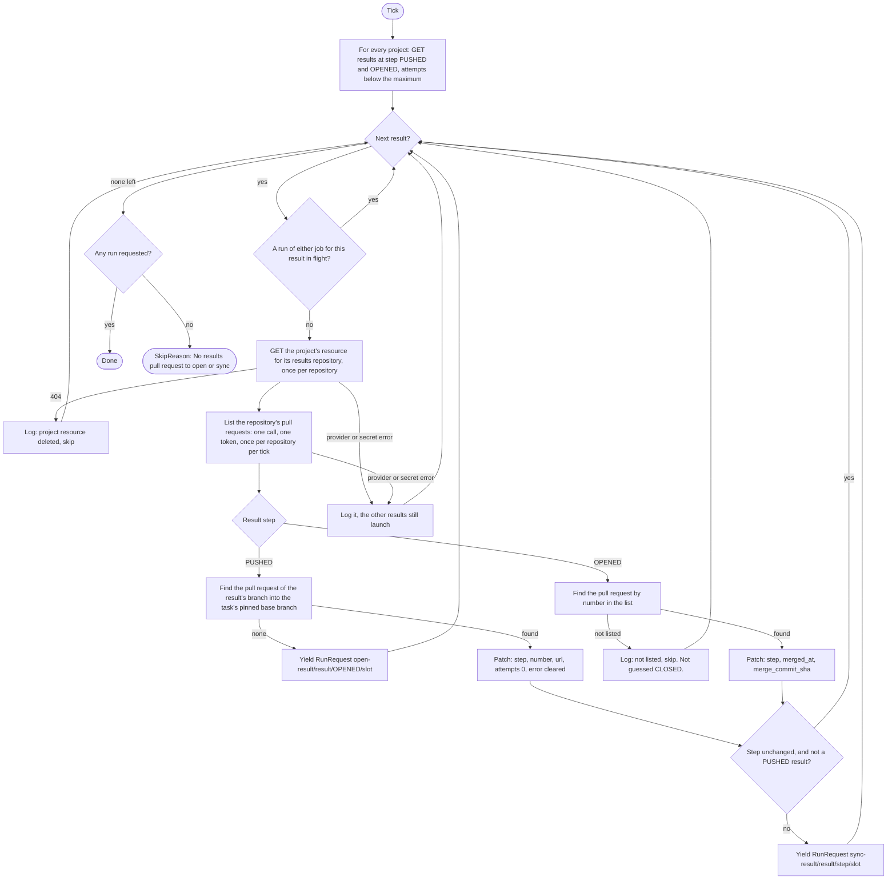
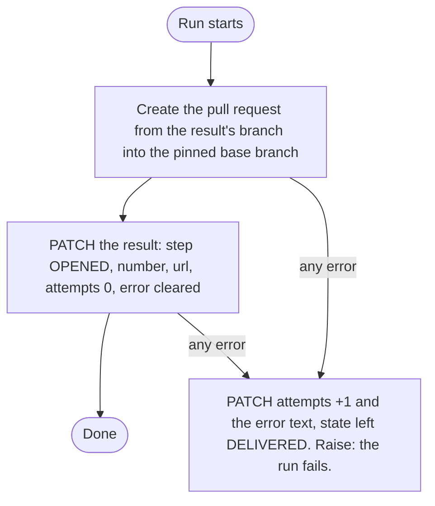
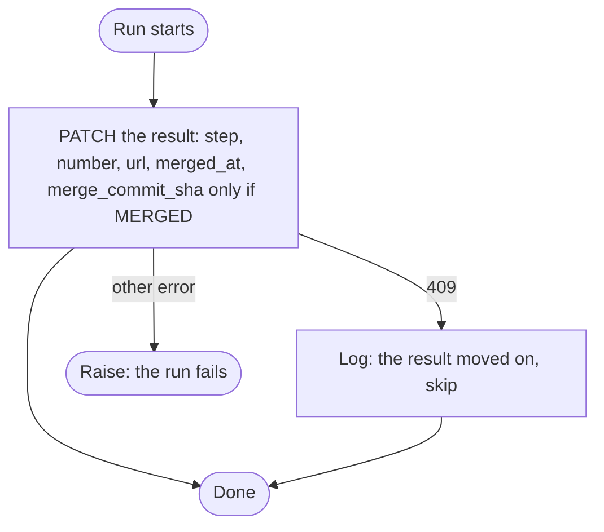

# Results pull request sync

Sensor `results_pull_request_sync_sensor` and its jobs `open_results_pull_request_job` and `sync_results_pull_requests_job`. Code: `dagster/app/definitions/sensors/task/pull_request_sync.py`. Index: [README](README.md).

## 1. Purpose

Opens the pull request of each pushed result, and records what the git provider says of it: opened, merged or closed. Delivery stops at the push (the result is `PUSHED` and `DELIVERED`); this sensor owns the pull request from there. A pull request that already exists for the result's branch (opened by hand, or by an earlier run whose patch failed) is recorded, not opened again. A failed push is not retried here; see [results delivery](results-delivery.md).

Push-only: a node that wants no results pull requests stops this sensor (Dagster UI, or `PATCH /dagster/sensors/<name>`), and its results stay at `PUSHED`. A result is always a pull request result: stopping the sensor pauses that step, it is not a product mode, and the results PR is the review gate.

## 2. When it runs

- Interval sensor, at most once per `DAGSTER_SENSORS_MIN_INTERVAL_SECONDS` (default 30 s).
- Starts `STOPPED` (`DAGSTER_SENSORS_INITIAL_STATUS`).
- The sensor reads the provider once per results repository per tick, whatever the number of results, and launches a run only for a result with no pull request yet or whose pull request differs from what the result records. An unchanged open pull request starts no run.
- Run key slot: `DAGSTER_SENSORS_RETRY_INTERVAL_SECONDS` (default 60 s). A change launches at once; a failed run is retried once per interval.

## 3. What it reads

| Who | Call | Filter or note |
|---|---|---|
| sensor | `GET /projects` | All projects. |
| sensor | `GET /projects/{id}/results` | `step=PUSHED` and `step=OPENED`, any state. `PUSHED` needs its pull request opened, or recorded if it exists; `OPENED` may be merged or closed since. Results with `attempts` at `DAGSTER_DELIVERY_MAX_ATTEMPTS` are dropped. |
| sensor | `GET /projects/{id}/repositories/results/{repo}` | The project's resource for the repository the result was delivered to, which may not be the project's current one. Read once per repository per tick. A deleted project resource is a 404. |
| sensor | `GET /projects/{id}/tasks/{task}/config` | `PUSHED` only: the task's pinned `base_branch`, which delivery used. |
| sensor | git provider | One paged list of the repository's pull requests (`state=all`, most recently updated first, back to the oldest result's creation) per tick, with the ResultsRepository's secret. `PUSHED`: the pull request from the result's branch into the pinned base branch. `OPENED`: the pull request by number. A result with a run in flight is skipped. |
| `open_results_pull_request_job` | `GET /global/repositories/results/{repo}`, the task's trigger | The repository's path, and the pull request's title and body, built as delivery builds the commit message. |
| `open_results_pull_request_job` | git provider | Creates the pull request. |
| `sync_results_pull_requests_job` | none | It only patches, with what the run config carries. |

It considers every project, the ProjectResultsRepository of each result (active or not) and the GlobalResource ResultsRepository through it.

## 4. Flow chart

Sensor (`ResultsPullRequestSyncSensor`, the tick loop of [base](base.md)):

Open job (`open_results_pull_request`), one result per run:

Sync job (`sync_results_pull_requests`), one result per run:

## 5. What it produces

| Output | Value |
|---|---|
| Run request | job `open_results_pull_request_job` for a `PUSHED` result with no pull request; job `sync_results_pull_requests_job` for a result whose pull request exists and differs from what it records. One per result. |
| Run key | `open-result/<result>/OPENED/<slot>`, or `sync-result/<result>/<step the result moves to>/<slot>` |
| Tags | `trigger=results-pr-sync`, `result_id` (never `trigger=task`: the run-status sensors act on that) |
| Run config | open: `project_id`, `result_id`, `task_id`, `results_repository_id`, `branch`, `base_branch`, `attempts`. Sync: `project_id`, `result_id`, `patch`. |
| Skip | `SkipReason("No results pull request to open or sync.")` |
| Result patch (open job) | `PATCH /projects/{id}/results/{result}` with `step=OPENED`, `number`, `url`, `attempts=0`, `error=null`. |
| Result patch (sync job) | `step`, `number`, `url`, `merged_at`, and `merge_commit_sha` (only when merged: a provider may fill it on an unmerged pull request). |

The pull request's title is the commit message of the delivery, `<trigger repo> PR<number> - task <id> - results`. Its body names the pull request that yielded the task and its merge commit.

## 6. Retries and failure handling

- Each tick lists the repository's pull requests again, so a result is checked on every tick until it is merged or closed. Results at `MERGED` or `CLOSED` are not read again.
- A failure to open the pull request is written on the result (`error`, `attempts` +1) and raised, so the run fails visibly. The state stays `DELIVERED`, so the delivery retry sensor (which takes `FAILED` only) leaves it alone. The next slot launches the open job again, until `attempts` reach `DAGSTER_DELIVERY_MAX_ATTEMPTS`; after that the sensor skips the result until `attempts` is reset by hand with a PATCH.
- A pull request listed for the branch is recorded, not opened again, so a run that opened it but failed to patch is healed on the next tick. The list goes back to the oldest result's creation, so a pull request created after its result is always inside it.
- An `OPENED` result whose pull request is not in the list stays at its last step and is skipped (logged).
- A 409 from the backend (the result moved on already) is logged and skipped by the sync job.
- Any other error while checking a result is logged and the other results still launch. The tick fails, naming the results, only when nothing launched ([base](base.md)). The check runs again on the next tick.
- A run in flight for a result, of either job, blocks a new one for it (`run_in_flight` with the result's tags).

## 7. How `enabled` and `revoked` change what it does

| State | Effect |
|---|---|
| Project or ProjectResultsRepository disabled | No effect: all projects are read, there is no `active_resource` filter, and the backend still hands out a token for a disabled one, so the pull request is opened or recorded. |
| Project or ProjectResultsRepository revoked | The tick still reads the result, but the open job's project-scoped token is refused (403): the run records the error and one more attempt and fails, until the attempts run out. The result stays `PUSHED`, no pull request is opened. A pull request already on the provider is still recorded. |
| ResultsRepository, GitProvider or Secret disabled or revoked | The backend refuses the sensor's own token for the repository (403). That result's check fails and is logged; the other results are still synced, and the tick fails only if nothing launched. Nothing is opened, the result stays `PUSHED`. |
| ProjectResultsRepository deleted | A 404: logged, the result is skipped. |
