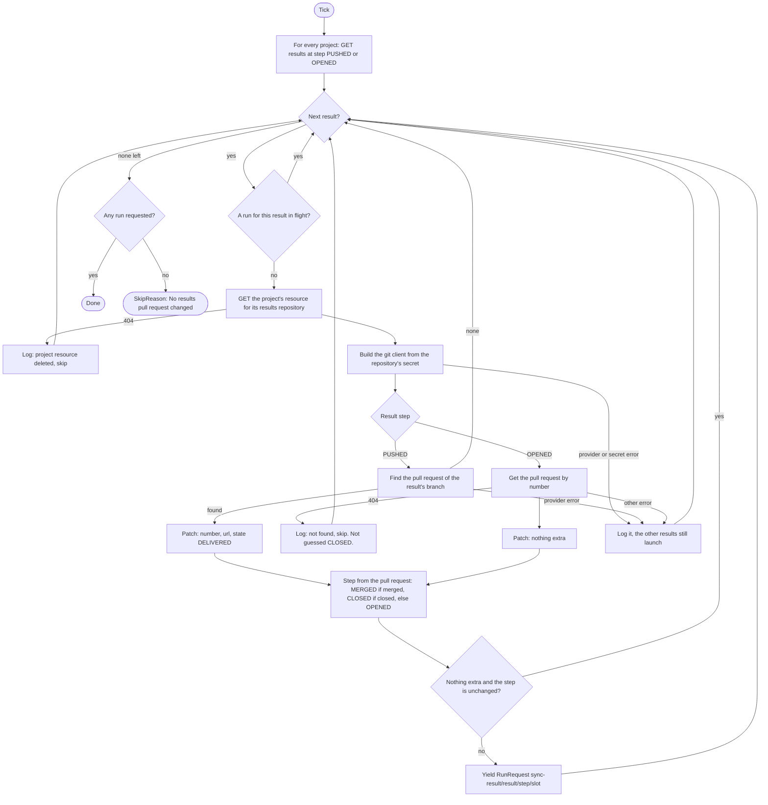
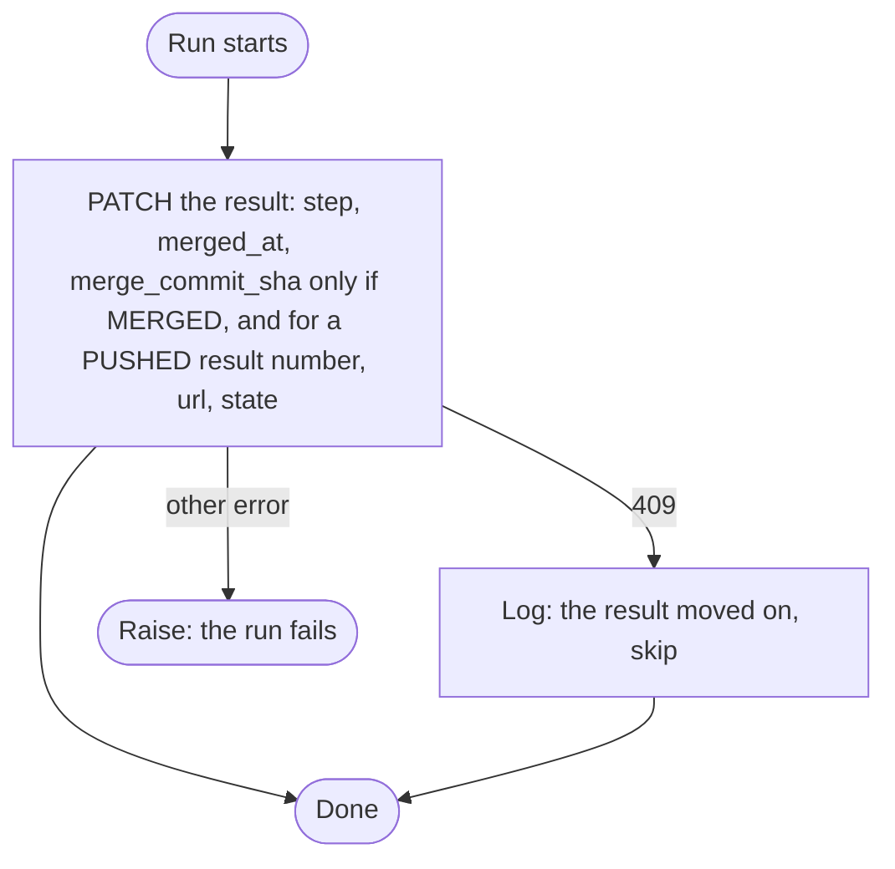

# Results pull request sync

Sensor `results_pull_request_sync_sensor` and its job `sync_results_pull_requests_job`. Code: `dagster/app/definitions/sensors/task/pull_request_sync.py`. Index: [README](README.md).

## 1. Purpose

Records what the git provider says about the pull requests that carry delivered results: that one was opened, merged or closed. It heals one failure only: a pull request that exists but that its result does not record. A failed delivery is not retried here; see [results delivery](results-delivery.md).

## 2. When it runs

- Interval sensor, at most once per `DAGSTER_SENSORS_MIN_INTERVAL_SECONDS` (default 30 s).
- Starts `STOPPED` (`DAGSTER_SENSORS_INITIAL_STATUS`).
- The sensor reads the provider on every tick, and launches a run only for a result whose pull request differs from what the result records. An unchanged open pull request starts no run.
- Run key slot: `DAGSTER_SENSORS_RETRY_INTERVAL_SECONDS` (default 60 s). A change launches at once; a failed run is retried once per interval.

## 3. What it reads

| Who | Call | Filter or note |
|---|---|---|
| sensor | `GET /projects` | All projects. |
| sensor | `GET /projects/{id}/results` | `step=PUSHED` and `step=OPENED`, any state. `PUSHED` may have a pull request its result missed; `OPENED` may be merged or closed since. |
| sensor | `GET /projects/{id}/repositories/results/{repo}` | The project's resource for the repository the result was delivered to, which may not be the project's current one. Read once per repository per tick. A deleted project resource is a 404. |
| sensor | git provider | `PUSHED`: the default branch, then the pull request of the result's branch. `OPENED`: the pull request by number. With the ResultsRepository's secret. A result with a run in flight is not read. |
| job | none | It only patches, with what the run config carries. |

It considers every project, the ProjectResultsRepository of each result (active or not) and the GlobalResource ResultsRepository through it.

## 4. Flow chart

Sensor (`ResultsPullRequestSyncSensor`, the tick loop of [base](base.md)):

Job (`sync_results_pull_requests`), one result per run:

## 5. What it produces

| Output | Value |
|---|---|
| Run request | job `sync_results_pull_requests_job`, one per changed result |
| Run key | `sync-result/<result>/<step the result moves to>/<slot>` |
| Tags | `trigger=results-pr-sync`, `result_id` (never `trigger=task`: the run-status sensors act on that) |
| Run config | `project_id`, `result_id`, `patch` |
| Skip | `SkipReason("No results pull request changed.")` |
| Result patch (job) | `PATCH /projects/{id}/results/{result}` with `step`, `merged_at`, and `merge_commit_sha` (only when merged: a provider may fill it on an unmerged pull request). A `PUSHED` result that has a pull request also gets `number`, `url` and `state=DELIVERED`. |

## 6. Retries and failure handling

- Each tick reads the results and their pull requests again, so a result is checked on every tick until it is merged or closed. Results at `MERGED` or `CLOSED` are not read again.
- A pull request deleted on the provider (404) stays at its last step and is skipped on every tick.
- A 409 from the backend (the result moved on already) is logged and skipped by the job.
- Any other error while checking a result is logged and the other results still launch. The tick fails, naming the results, only when nothing launched ([base](base.md)). The check runs again on the next tick.
- A failed run is retried at the next slot, while the result still differs from the provider.
- A run in flight for a result blocks a new one for it (`run_in_flight` with the result's tags).

## 7. How `enabled` and `revoked` change what it does

| State | Effect |
|---|---|
| Project disabled or revoked | No effect: all projects are read. |
| ProjectResultsRepository disabled or revoked, ResultsRepository or GitProvider disabled or revoked | The result is still synced. There is no `active_resource` filter: a pull request that exists is recorded whatever the project resource says. |
| ProjectResultsRepository deleted | A 404: logged, the result is skipped. |
| Secret disabled | The git client cannot be built (`PermissionError`). That result's check fails and is logged; the other results are still synced, and the tick fails only if nothing launched. |
