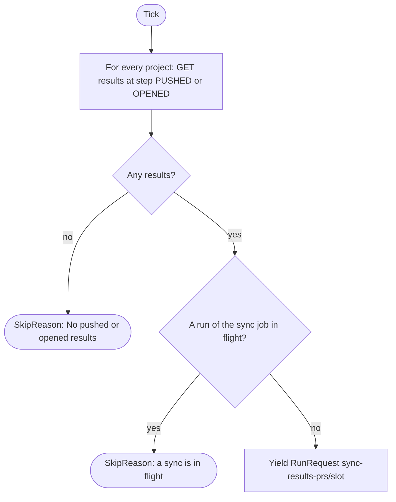
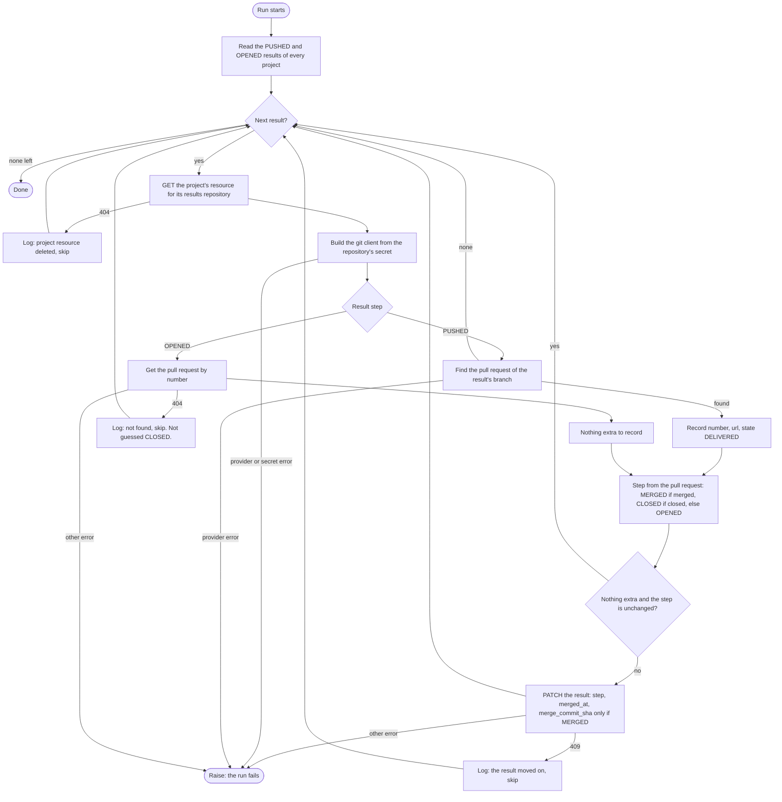

# Results pull request sync

Sensor `results_pull_request_sync_sensor` and its job `sync_results_pull_requests_job`. Code: `dagster/app/definitions/sensors/task/pull_request_sync.py`. Index: [README](README.md).

## 1. Purpose

Records what the git provider says about the pull requests that carry delivered results: that one was opened, merged or closed. It heals one failure only: a pull request that exists but that its result does not record. A failed delivery is not retried here; see [results delivery](results-delivery.md).

## 2. When it runs

- Interval sensor, at most once per `DAGSTER_SENSORS_MIN_INTERVAL_SECONDS` (default 30 s).
- Starts `STOPPED` (`DAGSTER_SENSORS_INITIAL_STATUS`).
- Run key slot: `DAGSTER_SENSORS_RETRY_INTERVAL_SECONDS` (default 60 s). While any result is `PUSHED` or `OPENED`, this makes a sync about once per interval: it is a poll.

## 3. What it reads

| Who | Call | Filter or note |
|---|---|---|
| sensor and job | `GET /projects` | All projects. |
| sensor and job | `GET /projects/{id}/results` | `step=PUSHED` and `step=OPENED`, any state. `PUSHED` may have a pull request its result missed; `OPENED` may be merged or closed since. |
| job | `GET /projects/{id}/repositories/results/{repo}` | The project's resource for the repository the result was delivered to, which may not be the project's current one. Read once per repository. A deleted project resource is a 404. |
| job | git provider | `PUSHED`: the default branch, then the pull request of the result's branch. `OPENED`: the pull request by number. With the ResultsRepository's secret. |

It considers every project, the ProjectResultsRepository of each result (active or not) and the GlobalResource ResultsRepository through it.

## 4. Flow chart

Sensor:

Job (`sync_results_pull_requests`):

## 5. What it produces

| Output | Value |
|---|---|
| Run request | job `sync_results_pull_requests_job`, at most one at a time |
| Run key | `sync-results-prs/<slot>` (no tags, no run config) |
| Skip | `SkipReason("No pushed or opened results.")` or `SkipReason("A sync of the results pull requests is in flight.")` |
| Result patch (job) | `PATCH /projects/{id}/results/{result}` with `step`, `merged_at`, and `merge_commit_sha` (only when merged: a provider may fill it on an unmerged pull request). A `PUSHED` result that has a pull request also gets `number`, `url` and `state=DELIVERED`. |

The sensor reads the same list as the job, only to decide whether to launch.

## 6. Retries and failure handling

- Each run reads the results again, so a result is checked on every run until it is merged or closed. Results at `MERGED` or `CLOSED` are not read again.
- A pull request deleted on the provider (404) stays at its last step and is skipped on every run.
- A 409 from the backend (the result moved on already) is logged and skipped; the other results are still synced.
- Any other error raises and the run fails. The results after the failing one wait for the next run, which starts at the next slot.
- A run in flight blocks a new one (`run_in_flight` with no tags: any run of this job).

## 7. How `enabled` and `revoked` change what it does

| State | Effect |
|---|---|
| Project disabled or revoked | No effect: all projects are read. |
| ProjectResultsRepository disabled or revoked, ResultsRepository or GitProvider disabled or revoked | The result is still synced. There is no `active_resource` filter: a pull request that exists is recorded whatever the project resource says. |
| ProjectResultsRepository deleted | A 404: logged, the result is skipped. |
| Secret disabled | The git client cannot be built (`PermissionError`). The run fails at that result, so results after it are not synced until the secret is enabled. |
