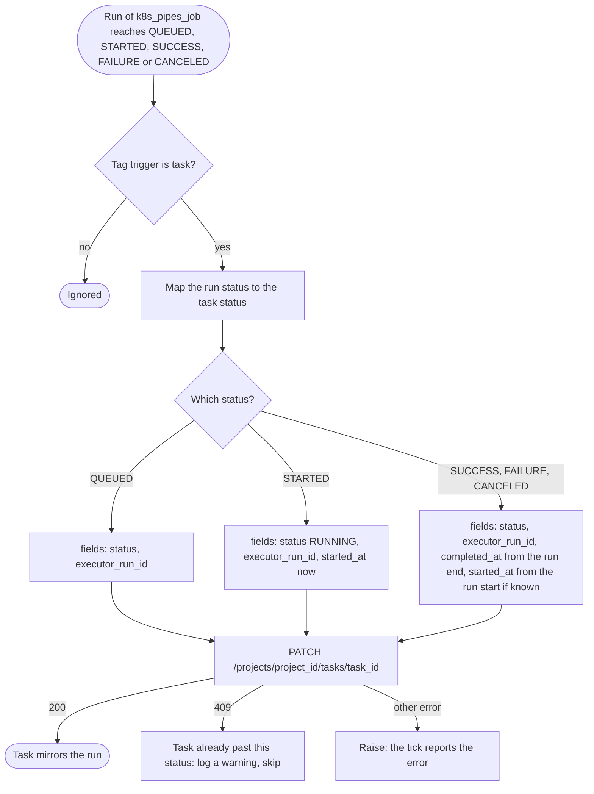
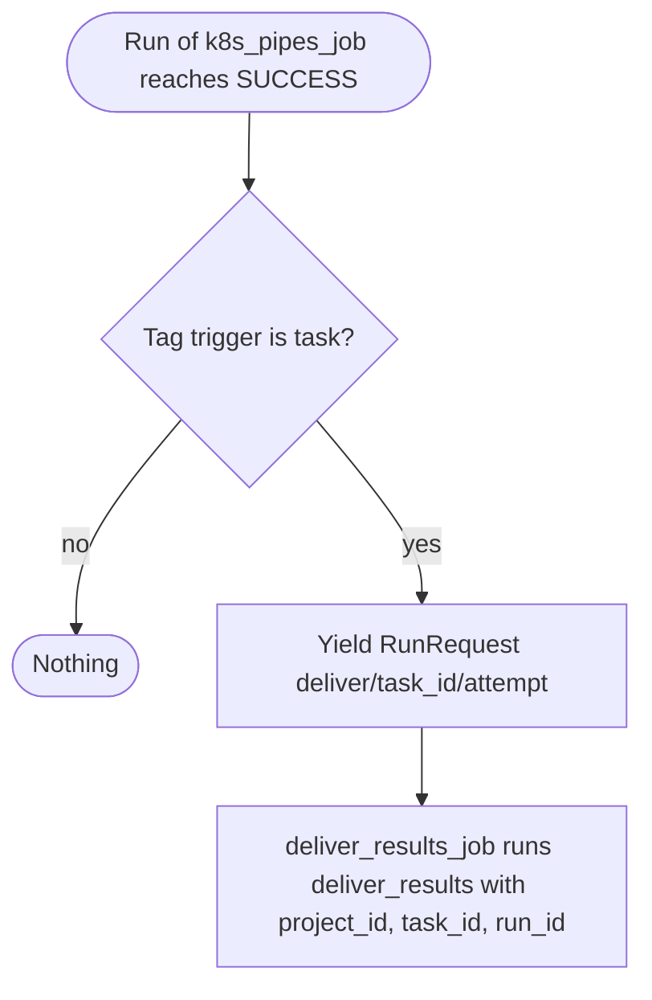

# Run-status sensors

Six sensors that react to a run of `k8s_pipes_job` reaching a status. Five mirror the status onto the task; one launches the delivery of the results. Code: `dagster/app/definitions/sensors/task/__init__.py` (the sensors), `run_status.py` (`TaskRunStatusSensor`), `delivery.py` (`task_results_delivery_sensor`). Index: [README](README.md).

| Sensor | Fires when the run is | Does |
|---|---|---|
| `task_queued_sensor` | `QUEUED` | task becomes `QUEUED` |
| `task_started_sensor` | `STARTED` | task becomes `RUNNING` |
| `task_success_sensor` | `SUCCESS` | task becomes `SUCCESS` |
| `task_failure_sensor` | `FAILURE` | task becomes `FAILED` |
| `task_canceled_sensor` | `CANCELED` | task becomes `CANCELED` |
| `task_results_delivery_sensor` | `SUCCESS` | launches `deliver_results_job` (see [results delivery](results-delivery.md)) |

## 1. Purpose

Keep a task's status the same as its Dagster run, and start the delivery of the results when the run succeeds. Besides these sensors, only the [reconcile sensor](task-reconcile.md) (it repairs an event they missed), the [launcher](task-launcher.md) (it fails a task that must not run) and the backend's retry call (back to `PENDING`) change a task's status.

## 2. When it runs

- Run-status sensors, evaluated at most once per `DAGSTER_SENSORS_MIN_INTERVAL_SECONDS` (default 30 s). Each fires once per run that reaches its status; a run can be seen at several statuses by different sensors.
- Start `STOPPED` (`DAGSTER_SENSORS_INITIAL_STATUS`).
- They watch only `k8s_pipes_job` (`monitored_jobs`) and act only on runs tagged `trigger=task`. A run started by hand, without that tag, is ignored.

## 3. What it reads

| Source | What |
|---|---|
| The run | Tags `trigger`, `task_id`, `project_id`, `attempt`; `run_id`; the run record for the start and end time. |
| The backend | Nothing. The status mirror builds its own backend client from `BackendConfig` for each event. |

It looks at no project, no ProjectResource and no GlobalResource: the run's tags say which task and project.

## 4. Flow chart

Status mirror (five sensors, one class):

Delivery on success:

## 5. What it produces

| Sensor | Output |
|---|---|
| Status mirror | `PATCH /projects/{project_id}/tasks/{task_id}` with `status` and `executor_run_id` (every status), `started_at` (when the run starts, and on a terminal status from the run record), `completed_at` (terminal statuses, from the run end). The exit code is not recorded: the run does not expose it. |
| Delivery on success | Run request for `deliver_results_job`. Run key `deliver/<task id>/<attempt>`. Tags `trigger=delivery`, `delivery_task_id=<task id>` (never `trigger=task` or `task_id`, so the mirror ignores the delivery run). Run config `deliver_results: {project_id, task_id, run_id}`. |

A short run can go from `STARTED` to its end between two ticks, so the `STARTED` event may be missed. Every status records the run id, and a terminal status takes the start time from the run itself.

## 6. Retries and failure handling

- Task statuses only move forward, and the backend refuses a move back or out of `SUCCESS`, `FAILED` or `CANCELED` with a 409. The mirror logs it and skips it. A status can be skipped over: `PENDING` can go straight to `SUCCESS`.
- Any other error (backend down, 5xx) is raised. Dagster still moves the sensor's cursor past that event, so it is not tried again. A later status of the same run can still move the task. A failed patch of the last status leaves the task at the one before; nothing retries it.
- The delivery sensor reads nothing, so it has nothing to fail on. It fires once per task attempt (the run key has no slot). A failed delivery is retried by the [delivery retry sensor](results-delivery.md); a manual task retry bumps `attempt` and so gets a new delivery key.

## 7. How `enabled` and `revoked` change what it does

They do not. The sensors follow runs, not projects: a run that was launched keeps being mirrored if its project is later disabled or revoked. For a revoked project, the task is failed by the [launcher](task-launcher.md) before it runs. A run already under way when the project is revoked ends normally, and the delivery job then gets a final REVOKED result from the backend and delivers nothing.
