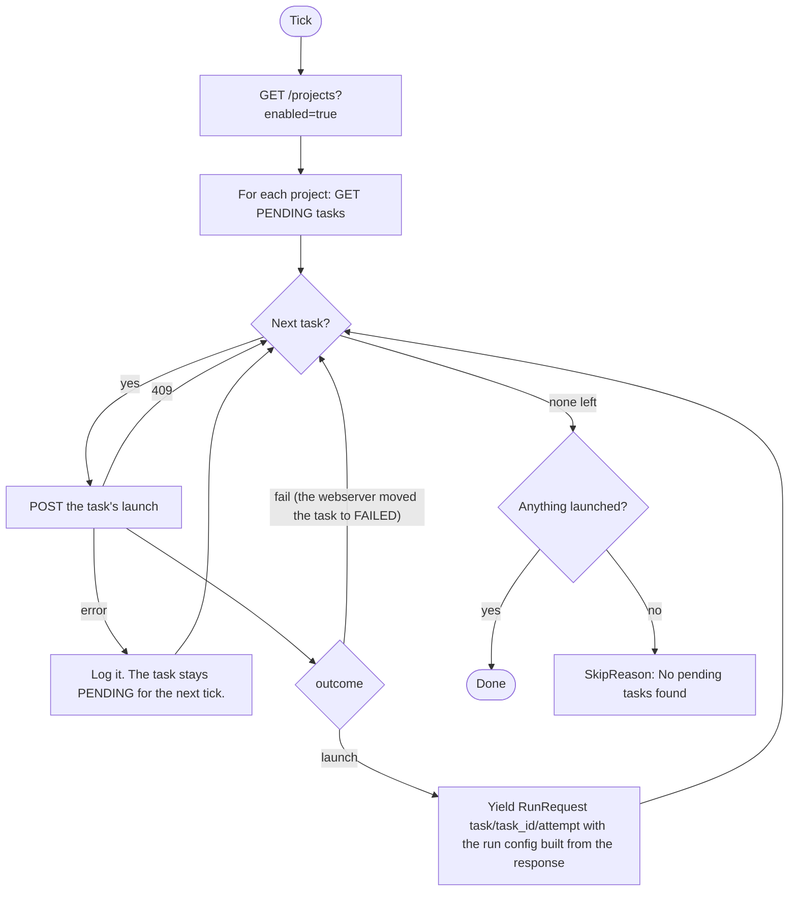

# Task launcher

Sensor `task_launcher_sensor` (`TaskLauncherSensor`) and the job it launches, `k8s_pipes_job`. Code: `dagster/app/definitions/sensors/task/launcher.py`, `task/__init__.py`, `definitions/jobs.py`, `pipes.py`, `run_config.py`. Index: [README](README.md).

## 1. Purpose

Launches a run of `k8s_pipes_job` for each PENDING task of an enabled project, whether a merged pull request or the API created it. For each task it makes one call to the webserver, which decides. The webserver owns the rules ([0021](../../../project/decisions/0021-webserver-owns-the-record-and-the-rules.md)): it fails a task with the cause itself, or answers with what the run needs, and the launcher launches it.

## 2. When it runs

- Interval sensor, at most once per `DAGSTER_SENSORS_MIN_INTERVAL_SECONDS` (default 30 s).
- Starts `STOPPED` (`DAGSTER_SENSORS_INITIAL_STATUS`).
- Its run key has no retry slot: `task/<task id>/<attempt>`. See [base](base.md).

## 3. What it calls

| Call | Filter or note |
|---|---|
| `GET /projects` | `enabled=true`, all pages of 100. A revoked project is still listed. |
| `GET /projects/{id}/tasks` | `status=PENDING`, all pages of 100. |
| `POST /projects/{id}/tasks/{task}/launch` | One per task. The decision: `outcome` (`launch` or `fail`) and `cause`. On `fail` the webserver has moved the task to `FAILED` itself. On `launch` it writes nothing and returns the task (spec included) and its dataset with the secret reference, which the run config is built from. A task no longer `PENDING` is a 409: skipped. |

It considers enabled projects and their PENDING tasks. Through the webserver's decision it covers everything a task uses: the project, the TriggerRepository (the link, the GlobalResource, its GitProvider), the Dataset (the ProjectDataset and the GlobalResource) and the ResultsRepository (the same three levels). It does not call the git provider.

## 4. Flow chart

## 5. What it produces

| Output | Value |
|---|---|
| Run request | job `k8s_pipes_job`, one per launchable PENDING task |
| Run key | `task/<task id>/<attempt>` |
| Tags | `trigger=task`, `task_id`, `attempt`, `project_id`, `project` (the name) |
| Run config | `k8s_pipes_op: {env, docker_image, dataset}` from the task spec; the dataset (name, host, port, type, schemas, secret reference) comes in the launch response and is left out when the task has none |
| Task write | None. On a failure the webserver sets `status=FAILED` and `state_cause`, cut to 1024 characters |
| Skip | `SkipReason("No pending tasks found.")` when nothing launched, even if some tasks were failed |

The launcher moves no task and writes nothing. The [run-status sensors](run-status.md) do once Dagster has the run, and until then the same request is yielded again each tick; the run key makes Dagster ignore it.

The job: `k8s_pipes_job` has one op, `k8s_pipes_op`. It starts the task pod from the task's image in the task namespace, with the task's env, the dataset's connection details, and a folder on the artifacts volume named after the run id (`ARTIFACT_PATH`).

## 6. Retries and failure handling

- The rules are final for that attempt. A failed task stays FAILED until a manual retry (`POST .../retry`), which sets it PENDING, adds one to `attempt` and clears `state_cause`. It then gets a new run key and launches once the cause is gone.
- An error while handling a task (the launch call fails) is logged. The task stays PENDING and is checked on the next tick. No run was created, so its run key is unused. One bad task does not stop the others.
- There is no retry slot and no in-flight check: one run per task attempt, de-duplicated by the run key. A run that fails is not relaunched; the task becomes FAILED through the status mirror.
- A failure while listing projects or tasks fails the tick.

## 7. How `enabled` and `revoked` change what it does

The webserver's rules run in this order ([0021](../../../project/decisions/0021-webserver-owns-the-record-and-the-rules.md)); `decide_launch` in `webserver/app/helpers/task_config.py` holds them. The first that applies fails the task.

| State | Effect |
|---|---|
| Project disabled | Not listed. Its PENDING tasks wait and launch once it is enabled. |
| Project revoked | Listed. Task FAILED, `revoked: project <name> (revoked)`. |
| TriggerRepository, its GitProvider or the ProjectTriggerRepository revoked | Task FAILED, `revoked: trigger repository ...`. Only for a task a pull request created. |
| Dataset, or the ProjectDataset (a deleted link counts), revoked | Task FAILED, `revoked: dataset ...`. |
| ResultsRepository, its GitProvider or the ProjectResultsRepository revoked or deleted | Task FAILED, `revoked: results repository ...`: its results could not be delivered. |
| Configuration changed since the task was created | Task FAILED, `task configuration changed since the task was created: ...`. A revoked cause wins over this one. |
| ProjectDataset or Dataset disabled | Not revoked, but not active: task FAILED, `Dataset <name> is not active in project <project>`. |
| Dataset secret disabled | Task FAILED, `The secret of dataset <name> is disabled`. |

Disabled (not revoked) triggers and results links do not stop a launch. A disabled results link is handled later, when the results are delivered.
