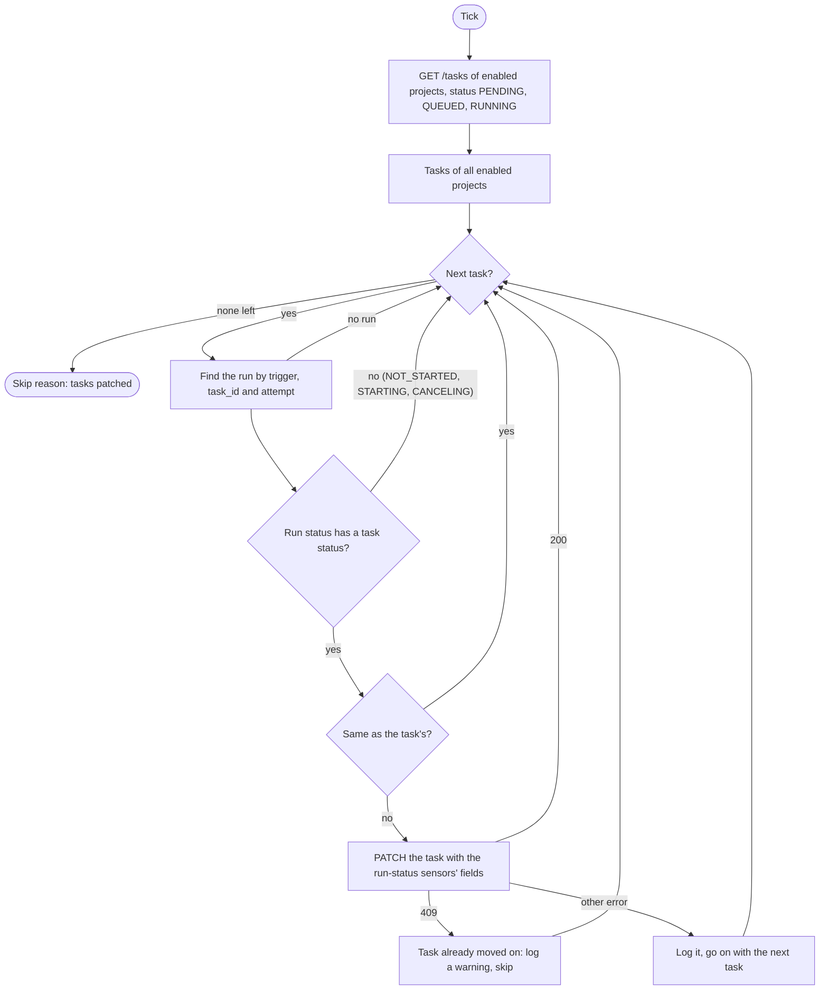

# Task reconcile

Sensor `task_reconcile_sensor` (`TaskReconcileSensor`). Code: `dagster/app/definitions/sensors/task/reconcile.py`; it reuses the status mapping of `run_status.py`. Index: [README](README.md).

## 1. Purpose

Keep every unfinished task at the status of its Dagster run, whatever the run-status sensors did. They react to a run changing status, so a run that started or finished while they were stopped or restarting leaves its task `PENDING`, `QUEUED` or `RUNNING`. This sensor reads the run's current status every tick instead, so the order in which sensors are started does not matter ([0003](../../../project/decisions/0003-task-status-written-by-run-status-sensors.md), [0014](../../../project/decisions/0014-dagster-pipeline-ops-sensors-and-retries.md)).

## 2. When it runs

- Interval sensor, at most once per `DAGSTER_SENSORS_MIN_INTERVAL_SECONDS` (default 30 s).
- Starts `STOPPED` (`DAGSTER_SENSORS_INITIAL_STATUS`).
- It launches nothing: it has no job and ends every tick with a skip reason that counts the tasks it patched.

## 3. What it reads

| Source | What |
|---|---|
| `GET /tasks` | `status=PENDING,QUEUED,RUNNING&project_enabled=true`, all pages of 100: one list per tick for all enabled projects, by id. nexus-api filters; nothing is filtered in Python. Each task carries its `project_id`, which the patch uses. |
| The Dagster instance | The newest run of `k8s_pipes_job` tagged `trigger=task`, `task_id` and `attempt` of the task (the tags the [launcher](task-launcher.md) sets, with the run key `task/<task id>/<attempt>`), and its run record for the start and end time. |

A task is matched to its run by task id and attempt, so the run of an earlier attempt is never used for a retried task.

## 4. Flow chart

## 5. What it produces

`PATCH /projects/{project_id}/tasks/{task_id}` with the fields the [run-status sensors](run-status.md) write for that status: `status` and `executor_run_id` (every status), `started_at` (`RUNNING`, and a terminal status from the run record), `completed_at` (terminal statuses, from the run end). The exit code is not recorded: the run does not expose it.

Left alone:
- a `PENDING` task with no run yet (the launcher owns it);
- a run that has no task counterpart yet;
- a task whose status is already the run's, so a run still `QUEUED` or `STARTED` causes no write.

## 6. Retries and failure handling

- Level-triggered: a task that could not be patched is read again on the next tick.
- Writes are safe to repeat. A finished task leaves the lists, and nexus-api's state tables refuse a move back or out of a final status with a 409 ([0005](../../../project/decisions/0005-state-transition-tables.md)). The sensor logs a 409 and skips the task.
- An error on one task (the backend, the instance) is logged and the others go on.

## 7. How `enabled` and `revoked` change what it does

It looks at the tasks of enabled projects only; a revoked project is still listed. A task of a disabled project is not touched. It applies no rule of its own: nexus-api decides whether a move is accepted.
