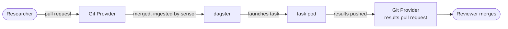

# Federated Node - Documentation

> **2.x beta.** This documentation covers the 2.x Federated Node, which is in beta.

This documentation covers deploying, setting up, testing, and using the PHEMS Federated Node (FN) 2.x.

## What is the Federated Node?

The Federated Node lets researchers run analytical tasks against sensitive datasets **without the data ever leaving your institution**. Analytics code (packaged as a Docker container) is sent to the data - not the other way around. Only the results come out, as a pull request that someone at your institution reviews before it is merged.

It deploys as a Helm chart onto a Kubernetes cluster. Tasks are asked for with a pull request, so nothing has to call into your node to start one.

Core components bundled in the chart:

- **nexus-api** - the FN API (FastAPI). It keeps the record of everything and decides what is allowed
- **Dagster** - polls the git repositories, starts task pods, and delivers results
- **Keycloak** - logins and the admin role
- **Traefik** - reverse proxy and ingress (recommended for production)
- **PostgreSQL** - FN metadata (projects, tasks, results) - you provide this externally in production

You also need a git host for the trigger and results repositories: GitHub (with a GitHub App) or Gitea. The chart can run a Gitea for development only.

## How a task runs

1. A researcher adds a small JSON file (the **task spec**: which image to run, which dataset) to the project's trigger repository, in a pull request.
2. Someone at the institution merges it.
3. The node sees the merged pull request, turns it into a task, and starts a pod in your cluster with the researcher's image, next to the dataset.
4. When the task finishes, the node pushes the result files to the project's results repository as a branch and opens a pull request.
5. Someone at the institution reviews that pull request. Merging it is the release of the results.

[Architecture](./Architecture) explains each part. [Researcher guide](./Researcher-Guide) shows the researcher's side.

## Where to start

**Understanding how it fits together:** [Architecture](./Architecture) covers the components, the flow, and the decisions you need to make yourself before production.

**Deploying for the first time:** [Prerequisites](./Prerequisites), then [Deploy: Core](./Deploy-Core) with the guide for your platform, then [Post-deploy testing](./Post-Deploy-Testing). The platform guides are [Azure (AKS)](./Deploy-Azure), [AWS (EKS)](./Deploy-AWS), [GCP (GKE)](./Deploy-GCP) and [On-Premises](./Deploy-On-Premises).

**Running tasks as a researcher:** [Researcher guide](./Researcher-Guide).

**Building an analytics container:** [Analytics container development](./Analytics-Container-Development) covers the environment variables, where to write results, and what the pod is and is not allowed to do.

**Registering the databases tasks read from:** [Datasets](./Datasets).

**Looking after a running node:** [Operations](./Operations).

What changed in each release is in the [release notes](https://github.com/Aridhia-Open-Source/PHEMS_federated_node/releases).
