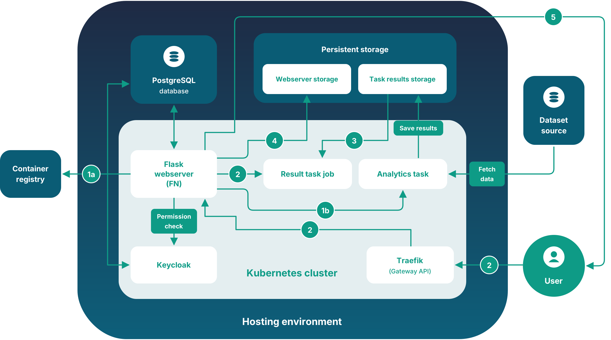

# Summary

The Federated Node is an open-source software component for running
federated analytics. It is based on existing open standards and is
designed to be easy to deploy, manage and integrate with existing
infrastructure within data controller's environment for a wide variety of
data types and use cases. It has been developed for the PHEMS consortium
and is already deployed at multiple partner sites, forming the basis of
their federated data sharing network.

# Statement of Need

Collaborative biomedical and clinical research increasingly depends on
access to diverse, curated real-world data. However, despite progress in
open science and digital health infrastructure, such collaboration
remains fragmented. Data are often siloed across institutions,
jurisdictions, and governance frameworks, particularly in domains such
as rare disease and cancer research where sample sizes are inherently
small and geographically dispersed. Harmonising and analysing these data
collectively are essential for scientific reproducibility and
translational impact [@LegidoQuigley2025].

Efforts to promote open and FAIR (Findable, Accessible, Interoperable,
Reusable) data practices have revealed the natural tension between data
accessibility and usability, and privacy protection. The introduction of
robust privacy legislation such as the EU’s General Data Protection
Regulation (GDPR) and equivalent frameworks worldwide has been vital in
safeguarding individual rights. Yet, the resulting regulatory and
technical fragmentation has made it increasingly difficult for
researchers to move, share, or co-analyse data across national borders
e.g. [@Mourby2019]. The European Health Data Space (EHDS) and
similar policy initiatives recognise that secure federated approaches,
where data remain within their source environments but can be analysed
collectively, are essential to balance privacy with scientific utility.

Federation has therefore emerged as a practical and ethical mechanism
for enabling cross-border research. Rather than copying or aggregating
sensitive datasets into central repositories, federated networks allow
analytical code to be executed remotely under the control of data
custodians, ensuring data never leave institutional boundaries. This
paradigm directly addresses legal and ethical constraints on
cross-border data movement while maintaining auditability and governance
alignment with local policies [@EradatOskoui2025]. The success
of nationwide federated EHR networks in routine emergency-care research
[@Bienzeisler2025] demonstrates that such infrastructures are now
technically feasible and not merely conceptual.

# State of the field
While the technical foundations for federated analytics and learning are
in place, translating them into practice remains challenging. Even
comprehensive frameworks such as the [GA4GH Task Execution Service](https://www.ga4gh.org/product/task-execution-service-tes/) and the
[ICODA Common API](https://github.com/federated-data-sharing/common-api
) cannot, by themselves, overcome the deep heterogeneity that exists in
real-world healthcare systems. Recent reviews of federated learning in
medicine emphasise that most studies still fail to reach clinical
utility, citing issues such as non-identical data distributions,
methodological bias, heavy communication overheads, and incomplete
governance alignment [@Li2025;@Joshi2022]. A recent
systematic review found that of more than 22,000 papers screened, fewer
than 6 per cent involved genuine real-world deployments, underscoring
persistent barriers to clinical translation [@Teo2024].
Large-scale national programmes such as Australian Genomics further
highlight the operational and governance coordination required even
before federated analytics are introduced [@Stark2023]. These
findings collectively illustrate that while federation is technically
feasible, its successful implementation demands
standards-aligned infrastructure that reduces operational friction and
lowers the barrier for adoption.

Despite these advances, establishing and maintaining interoperable
federated networks remains complex. Implementations often require
substantial local customisation to integrate with existing
authentication, container orchestration, and registry systems. There is
therefore a pressing need for an open and reproducible
reference implementation that lowers the barrier for organisations to
participate in federated research while building on the GA4GH Task
Execution Service (TES) specification.

The Federated Node (FN) addresses this need by operationalising the
ICODA Common API into a deployable, open-source package built from
widely adopted components (Keycloak, Traefik, PostgreSQL, Kubernetes). FN
allows institutions to host secure, standards-based endpoints
capable of executing authorised analytical tasks against local datasets,
thereby enabling scalable, privacy-preserving, cross-institutional
collaboration aligned with international standards.

By operationalizing existing specifications rather than creating proprietary approaches, the FN lowers adoption barriers while supporting interoperability, as illustrated by its use in the PHEMS network described below.

# Research Impact Statement
The FN was developed for, and is used within, the [PHEMS](https://phems.eu) (Pediatric Hospitals as European drivers for multi-party computation and synthetic data generation) consortium, a collaboration between four European children's hospitals and industry partners to build a federated
network for paediatric and rare disease research. Each participating
hospital deploys an FN in its own environment, while analytical code is
managed in a shared GitHub organisation; approved changes are pulled into
each hospital's FN via ArgoCD, so no inbound connections to hospital
networks are required [@AridhiaPHEMS2025].

The first test of the core network, in March 2025, ran the PHEMS clinical benchmarking use case on data mapped to the OMOP Common Data Model, using FNs deployed at Great Ormond Street Hospital and Helsinki University Hospital, with results returned either to GitHub or directly to an analysis workspace [@AridhiaPHEMS2025]. Onboarding of the four founding
hospitals followed [@AridhiaPHEMS2026a], and the network now provides a
production-ready federated benchmarking capability that allows members to
compare clinical outcomes [@AridhiaPHEMS2026b]. The network is intended to
form the basis of the Paediatric Health Data Space, presented publicly in
2026 [@AridhiaPHEMS2026a; @i4KIDS2026]. 

# Software Design
The International Covid-19 Data Alliance ([ICODA](https://icoda-research.org/ICODA)) developed the [Federated Data Sharing Common API](https://github.com/federated-data-sharing/common-api) or "Common API" as an open standard for a federated data sharing API, as described elsewhere. The Common API is a constrained implementation of the Global Alliance for Genomics and Health [Task Execution Service](https://www.ga4gh.org/product/task-execution-service-tes/), containing components for meta-data browsing, remote data selection and federated computation.

The Federated Node (FN) builds upon this open standard, and provides a
practical, working implementation of the standard that can be easily
deployed and operated within federated research networks. The FN packages
an implementation of the Common API with other open-source components
including:

- The Common API
- [Keycloak](https://www.keycloak.org/)
- [Traefik](https://traefik.io/), via the Kubernetes [Gateway API](https://gateway-api.sigs.k8s.io/)

The Common API specifies a set of endpoints that provide a framework for organisations that wish to collaborate on federated data sharing and analysis. It provides the structure of the Federated Node API.

The FN implements the Common API rather than the full TES specification.
Its task endpoints follow the TES model (`POST /tasks` to submit a task,
`GET /tasks` and `GET /tasks/{id}` to list and inspect tasks, and
`POST /tasks/{id}/cancel` to cancel one), but differ from TES in some
details, such as the form of the cancel path. The FN also adds endpoints
that TES does not define, for dataset metadata, container registries,
audit logs and result review.

Keycloak is used for token and user management. Incoming requests are
routed through Kubernetes Gateway API resources (a Gateway and
HTTPRoutes), with Traefik as the gateway controller; the Helm chart can
optionally install Traefik itself. Releases before 1.8.0 used
nginx-ingress instead.

Federated Node deployments use widely adopted open-source technologies.
FNs are deployed to a Kubernetes cluster using a Helm chart
and require a PostgreSQL database, which holds Keycloak's identity data
and the FN's own records of datasets, registries, containers, tasks and
audit events. Each Federated Node is also associated with one or more
configured container registries (for example Azure Container Registry,
GitHub Container Registry or other Docker-compatible registries), which
hold the task images that can be run against the data. Task results are
written to configured persistent storage (local, NFS, Azure Files or AWS
EFS volumes at the reviewed release).

\autoref{fig:figure1} below describes how a federated task is processed when
initiated by an authenticated user:

- *1a* Before creating the task pod, the FN checks that the requested container image is available in one of the container registries configured for the FN.

- *1b* The task pod is created, and the results are saved in the
  condfigured persisten storage.

- *2* On calls to the `/tasks/{id}/results` endpoint, if the task pod is on completed status, a job
  is created.

- *3* The job’s pod mounts both the task's and the webserver's
  persistent storage. It fetches the task's results folder and zips it.

- *4* The webserver reads the zip contents from the live job pod and
  saves it in its own presistent storage.

- *5* The resulting archive is returned to the end user

This architecture gives data owners several layers of control over what
is run against their data and what leaves their environment. Task images
must be registered with the FN and held in one of its configured
container registries; users authenticate through Keycloak and need the
appropriate role and dataset permission to submit tasks; non-admin users
can only access their own tasks; and task-related API calls are recorded
in an audit log. Data owners can additionally enable result review, in
which case results are released to users only after an administrator
approves them. These controls operate alongside the hosting
institution's own Kubernetes RBAC, network and registry access policies.

## Experimental AI extension
An experimental fork,
[Federated Node AI](https://github.com/Aridhia-Open-Source/federated_node_ai),
explores adding an `/ask` endpoint that sends a user's prompt, together
with data retrieved locally by the FN, to a small language model hosted
in the same environment as the data. This work is at an early stage, is
not part of the software described in this paper, and significant
security and reliability questions would need to be resolved before
such an approach could be used with sensitive data.

# PHEMS
The following members of the PHEMS ("Pediatric Hospitals as European
drivers for multi-party computation and synthetic data generation
capabilities across clinical specialities and data types") consortium
contributed substantially to this work from their institutions over the
course of the project, including the use cases, requirements and
validation for the FN. Because of the size of the consortium, and at its
request, they are credited collectively through the group author PHEMS
rather than listed individually in the author list:

- Valts Abols, Children's University Hospital Latvia
- Lydia Briggs, Great Ormond Street Hospital
- Patricia Garcia Cañadilla, Sant Joan de Déu Barcelona Hospital 
- Beatrice Casarella, Meyer Children's Hospital
- Marinel Cavelaars, The Hyve 
- Bruno De Brito Robalo, Erasmus University Medical Centre
- Teemu Ekola,  Tietoevry
- Roger Domingo Espinos, Sant Joan de Déu Barcelona Hospital
- Arnau Valls Esteve, Sant Joan de Déu Barcelona Hospital
- Josep Lluís Falcó, Genesis Biomed 
- Eric Fey, HUS Helsinki University Hospital
- Janne Hämäläinen, Tietoevry
- Tiia Hautaniemi, HUS Helsinki University Hospital
- Liisa Henriksson, HUS Helsinki University Hospital
- Cristina Ruiz Herguido, Sant Joan de Déu Barcelona Hospital
- Riku Hietaniemi, Tietoevry
- Mikko Juvonen, HUS Helsinki University Hospital
- Nora Kaufmane, Children's University Hospital Latvia 
- Pekka Kahri, HUS Helsinki University Hospital 
- Jari Kautiala, Tietoevry
- Daniel Key, Great Ormond Street Hospital 
- Daniel Ormazabal Kirchner, Sant Joan de Déu Barcelona Hospital
- Signe Koritko, Children's University Hospital Latvia
- Jan Willem Kuiper, Erasmus University Medical Centre
- Satu Långström, HUS Helsinki University Hospital
- Gary Zhen Yuan Liew, Great Ormond Street Hospital
- Ron Mathot, Amsterdam University Medical Centre
- Kathleen McGreevy, Meyer Children's Hospital
- Jennifer McIntosh, Sant Joan de Déu Barcelona Hospital 
- Ruben Berrueco Moreno, Sant Joan de Déu Barcelona Hospital 
- Claudia Ibabe Muñoz, Sant Joan de Déu Barcelona Hospital 
- Tomi Mustonen, Tietoevry
- Daniel Nguyen, Veil AI 
- Ieva Poča, Children's University Hospital Latvia
- Inese Gobiņa, Children's University Hospital Latvia
- Antti Saarela, Tietoevry
- Jordi Ortiz Sagrista, Genesis Biomed
- Jonna Salminen, HUS Helsinki University Hospital 
- Hannele Salonen, HUS Helsinki University Hospital
- Nikolas Salonen, HUS Helsinki University Hospital 
- Dace Ševčenko, Children's University Hospital Latvia
- Ignus Sinkovski, Children's University Hospital Latvia
- Ieva Studente, Children's University Hospital Latvia 
- Azadeh Tafreshiha,The Hyve 
- Andrew Taylor, Great Ormond Street Hospital 
- Jan van den Brand, Erasmus University Medical Centre 
- Aida Felipe Villalobos, Sant Joan de Déu Barcelona Hospital
- Anniina Wäyrynen, Veil AI

# Author contributions
R.C. and R.S. designed and developed the software.  S.R., R.B. and D.S provided oversight of the project. PHEMS contributed use cases that informed requirements and validation. All authors contributed to the writing and/or review of the manuscript.

# AI usage disclosure
No generative AI coding assistants were used in writing the Federated
Node code up to version 1.9.0, the version submitted for review. Some
later changes include fixes suggested by GitHub Copilot Autofix, and
Claude (Anthropic) has been used to draft design documents on
development branches. Generative AI tools may also have been used to
assist with parts of the project documentation. All such changes are
reviewed by the development team before being merged.

The original manuscript was written by the authors without AI
assistance. During revision in response to peer review, Claude Opus
(Anthropic) was used to cross-check the manuscript against the source
code and reviewer comments, identify inaccurate statements, locate
public supporting sources, and draft revised wording for several
sections, including the Research Impact Statement and Software Design.
The authors reviewed, edited and verified all suggested text against the
code and the cited sources, made all decisions about content, and take
full responsibility for the paper.

# Acknowledgements
This work was supported by the PHEMS project, funded by the European
Commission (grant agreement 101094195) and UK Research and Innovation
(grants 10103155 and 10141098).

We would like to thank the following people for their contributions to
the Federated Node project: Hepzibah Faustina and Marco Luk for their
assistance testing and deploying the FN; George Eddie, Ross Hannah,
Finlo Boyle, Chi-Hao Huang for their code reviews and oversight; Eoghan
Forde and Deepak Sehgal for project management support; and Matt Western
and Daniel Morris for their assistance in preparing the paper.

# References
