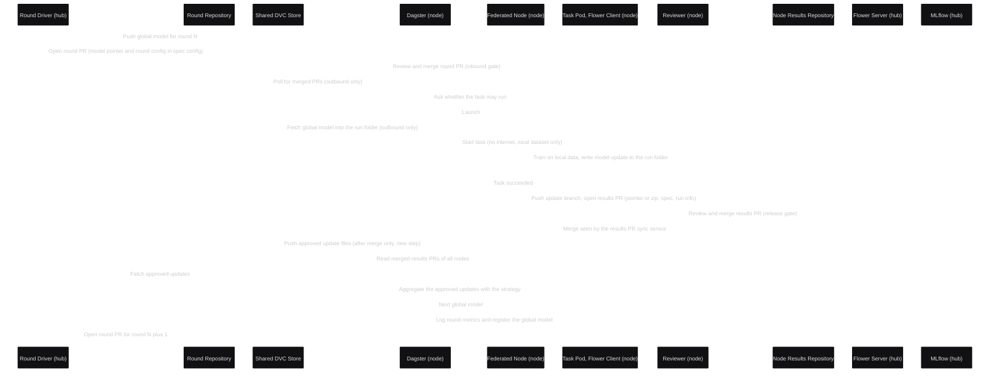

# 0043. Federated Machine Learning

Status: Proposed, 2026-11-26.

## Context

- **PHEMS needs to train models across sites without moving the data.** Each site keeps its rows. Only approved model updates leave.
- **The sandbox already has a design.** `phems-sandbox` plans a hub and spoke ([NOTES.md](https://github.com/Aridhia-Open-Source/phems-sandbox/blob/main/node/project/NOTES.md), 2025-10/11; [orchestrator diagram](https://github.com/Aridhia-Open-Source/phems-sandbox/blob/main/node/project/diagrams/orchestrator/architecture.md)). Nodes train locally. A central Dagster orchestrator aggregates. MLflow tracks metrics and holds a model registry. Its [ADR 001](https://github.com/Aridhia-Open-Source/phems-sandbox/blob/main/node/project/decisions/adr-001-dagster-orchestration-framework.md) chose Dagster and its [ADR 002](https://github.com/Aridhia-Open-Source/phems-sandbox/blob/main/node/project/decisions/adr-002-data-version-control.md) chose DVC (Data Version Control, git-tracked pointers to large files).
- **MLflow ran once, then was switched off.** [Sandbox PR #7](https://github.com/Aridhia-Open-Source/phems-sandbox/pull/7) put MLflow on Kubernetes with a Dagster training asset. Its bitnami image was later discontinued, so [`apply.sh`](https://github.com/Aridhia-Open-Source/phems-sandbox/blob/main/node/k8s/apply.sh) scales it to 0.
- **Flower was tried on its own.** `flower-demo` (private repository) runs a Flower federated regression across 3 sites. It is not wired into the Federated Node.
- **Earlier Federated Node work, all on GitHub:**
  - [#35](https://github.com/Aridhia-Open-Source/PHEMS_federated_node/issues/35): Substra spike, closed, not taken forward.
  - [#218](https://github.com/Aridhia-Open-Source/PHEMS_federated_node/issues/218): the Erasmus model on a Dagster proof of concept, closed.
  - [#247](https://github.com/Aridhia-Open-Source/PHEMS_federated_node/issues/247): several training rounds in Dagster, open.
  - [#270](https://github.com/Aridhia-Open-Source/PHEMS_federated_node/issues/270): a task controller custom resource for ML, closed.
  - [#474](https://github.com/Aridhia-Open-Source/PHEMS_federated_node/issues/474): bring back the legacy models, open.
- **The node already has a governed path in and out.** A merged pull request starts a task ([0001](0001-polymorphic-triggers.md), [0011](0011-pull-requests-stored-once-fan-out-and-cursors.md)). The result comes back as a results pull request a person reviews ([0013](0013-results-delivered-as-branch-and-pull-request.md)). A task has no internet ([0022](0022-task-isolation.md#4-network-a-task-pod-reaches-the-database-and-nothing-else)). Training should use that path, not go around it.

## Decision

### Who does what

| Part | Job | Where |
|---|---|---|
| Flower | Trains (clients) and aggregates (server strategy, for example FedAvg). | Client code in the task. Strategy at the hub. |
| MLflow | Records each round's runs and metrics. Holds the model registry. | Hub. |
| Federated Node | Governance: access, approvals, datasets, running tasks, results review. | Each node. |
| Dagster | Schedules and tracks the runs, and delivers results. | Each node. |
| DVC | Moves model files across the node boundary. Only pointers go in the pull requests. | Git plus a DVC store. |

- **Flower replaces the aggregation the sandbox planned to build in Dagster.** It replaces nothing in the Federated Node.
- **The Federated Node does not change who decides.** nexus-api owns the record and the rules ([0021](0021-nexus-api-owns-the-record-and-the-rules.md)). A training task is an ordinary task.

### A training round is a pull request cycle

1. **The hub opens a round pull request.** It carries the round config and the global model, or a DVC pointer to it. The model and round config ride in the task spec's existing `config` field, which is free JSON ([0002](0002-task-spec-and-derivation.md)). No new spec field.
2. **Each node's trigger picks up the merged pull request** and runs a local training task: Flower client code, run once per round, against the node's local dataset.
3. **Each node returns its model update as a results pull request** ([0013](0013-results-delivered-as-branch-and-pull-request.md)). A reviewer at the node approves it.
4. **The hub aggregates the approved updates.** The Flower strategy runs at the hub on the stored updates. The hub logs the round to MLflow, registers the new global model, and opens the next round's pull request.

Two rules hold in every round:

- **Every update is reviewed before it leaves the node.** Until its results pull request is merged, an update stays in node storage and is not pushed to any shared store.
- **Nothing connects into a node, and a task gets no new network route.** Dagster at the node polls and pushes outward. The task stays default-deny ([0022](0022-task-isolation.md)).

### Where the data goes

- **The model reaches the task through the run's folder, not the network.** The task pod cannot reach the internet. Before it starts, the Dagster run pod, which does have outbound access, fetches the global model from the DVC store into the run's artifacts folder.
- **A small update rides in the results zip as today.** Up to the 10 MiB cap ([0013](0013-results-delivered-as-branch-and-pull-request.md)).
- **A large update goes by DVC pointer.** The files stay in the node's internal DVC storage. The results branch carries the pointer file and `run.json`. The reviewer pulls the files from the node to inspect them. When the results pull request is merged, a new step pushes the files to the shared DVC store, where the hub fetches them. This follows the sandbox's "Publish Results" flow ([sequence](https://github.com/Aridhia-Open-Source/phems-sandbox/blob/main/node/project/diagrams/repos/sequence.md)).
- **This revisits 0013 for models only.** 0013 left DVC out because the sizes then in scope were small. Model files are where they are not. Everything else keeps the zip.

### Component view

```mermaid
---
config:
  layout: elk
  look: classic
  theme: redux-dark
---
flowchart TD

  %% ------------------ Hub ------------------
  subgraph Hub["Hub"]
    Driver("Round Driver: opens round PRs, collects approved updates")
    FlowerServer("Flower Server: strategy (for example FedAvg) aggregates updates")
    subgraph MLflow["MLflow"]
      Tracking("Tracking Server: runs and metrics")
      Registry("Model Registry: global models")
    end
  end

  %% ------------------ Shared ------------------
  subgraph Shared["Shared: git host and DVC store"]
    RoundRepo("Round Repository: round PRs")
    DvcShared("Shared DVC Store: model files")
    Results1("Results Repository of Node 1")
    Results2("Results Repository of Node 2")
  end

  %% ------------------ Node 1 ------------------
  subgraph Node1["Node 1"]
    Reviewer1("Reviewer (person at the node)")
    FN1("Federated Node: access, approvals, task rules")
    Dagster1("Dagster: sensors, runs, delivery")
    Internal1("Internal DVC Storage: updates held until approved")
    Data1("Local Datasets")
    subgraph TaskNs1["Task pod, no internet"]
      Client1("Flower Client: trains locally")
    end
  end

  %% ------------------ Node 2 ------------------
  subgraph Node2["Node 2"]
    Reviewer2("Reviewer (person at the node)")
    FN2("Federated Node: access, approvals, task rules")
    Dagster2("Dagster: sensors, runs, delivery")
    Internal2("Internal DVC Storage: updates held until approved")
    Data2("Local Datasets")
    subgraph TaskNs2["Task pod, no internet"]
      Client2("Flower Client: trains locally")
    end
  end

  %% ------------------ More nodes ------------------
  MoreNodes("Node 3 and more: same parts as Node 1")

  %% ------------------ Hub wiring ------------------
  Driver -->|"hand approved updates to"| FlowerServer
  FlowerServer -->|"return next global model to"| Driver
  Driver -->|"log metrics of each round"| Tracking
  Driver -->|"register each global model"| Registry
  Driver -->|"open round PR"| RoundRepo
  Driver -->|"push global model files"| DvcShared
  Driver -->|"read merged results PRs"| Results1
  Driver -->|"read merged results PRs"| Results2
  Driver -->|"fetch approved updates"| DvcShared

  %% ------------------ Node 1 wiring ------------------
  Dagster1 -->|"poll for merged round PR (outbound only)"| RoundRepo
  Dagster1 -->|"ask: may this task run?"| FN1
  Dagster1 -->|"fetch global model into run folder (outbound only)"| DvcShared
  Dagster1 -->|"start task with model and round config"| Client1
  Client1 -->|"read rows (read only)"| Data1
  Client1 -->|"write model update to run folder"| Dagster1
  Dagster1 -->|"hold large update files"| Internal1
  Dagster1 -->|"push update branch, open results PR"| Results1
  Reviewer1 -->|"review and merge results PR"| Results1
  Dagster1 -->|"after merge only: push update files"| DvcShared

  %% ------------------ Node 2 wiring ------------------
  Dagster2 -->|"poll for merged round PR (outbound only)"| RoundRepo
  Dagster2 -->|"ask: may this task run?"| FN2
  Dagster2 -->|"fetch global model into run folder (outbound only)"| DvcShared
  Dagster2 -->|"start task with model and round config"| Client2
  Client2 -->|"read rows (read only)"| Data2
  Client2 -->|"write model update to run folder"| Dagster2
  Dagster2 -->|"hold large update files"| Internal2
  Dagster2 -->|"push update branch, open results PR"| Results2
  Reviewer2 -->|"review and merge results PR"| Results2
  Dagster2 -->|"after merge only: push update files"| DvcShared

  %% ------------------ More nodes wiring ------------------
  MoreNodes -->|"poll round PR, open results PR, push approved files"| Shared
```

### One round, in order

## Consequences

- **Fully governed and auditable.** Each step is a pull request or a Federated Node record. Who approved which update is in git.
- **It fits the node's rules.** No inbound connection to a node, and no new network route for a task.
- **It is slow.** A round waits for the slowest approval at the slowest node. This suits a few rounds, not hundreds.
- **Flower is used for its client and strategy code, not its live round loop.** The client trains once per task. The strategy runs on stored updates. A short spike must confirm the strategy code can run that way.
- **Needs DVC remote storage** for models and large updates, one internal store per node and one shared store. The Federated Node has no DVC today.
- **MLflow needs a supported image.** The one the sandbox used is discontinued. Which one is open.
- **To build, so the two rules above hold:**
  - A step before launch that fetches the global model into the run's folder. A task has no network, so the Dagster run pod does it.
  - Delivery that keeps a large update in node storage and puts a DVC pointer in the results branch.
  - A step after MERGED that pushes the update files to the shared store. Nothing runs after MERGED today ([0015](0015-run-keys-retries-and-results-pr-sync.md)).
  - The round driver at the hub, and a training task image with Flower client code.
- **An approved update can still leak information about the data.** Review is a person's check, not a privacy proof (see open questions).

## Alternatives considered

- **Live Flower (SuperLink and SuperNode over gRPC) with an approved route from tasks to the hub server.** Fast, and many rounds are cheap. But updates leave the node without review, and every node needs an exception to default-deny egress ([0022](0022-task-isolation.md)). A task would also stay up for the whole run. Not taken for the default path; a later ADR may allow it for trusted networks.
- **Substra.** Rejected in [#35](https://github.com/Aridhia-Open-Source/PHEMS_federated_node/issues/35).
- **Aggregation built in Dagster (the sandbox plan).** We would write and keep FedAvg and the other strategies ourselves. Flower already has them.
- **MLflow artifacts instead of DVC.** Rejected in the sandbox's [ADR 002](https://github.com/Aridhia-Open-Source/phems-sandbox/blob/main/node/project/decisions/adr-002-data-version-control.md): no git approval flow. MLflow stays for tracking and the registry only.

## Open questions

- **Who merges the round pull request, and where does it go?** One shared round repository for all nodes, or one trigger repository per node. Each node's merge is the approval to train.
- **Who reviews an update, and what do they check?** Shape and size, metrics, whether the update looks like it encodes rows.
- **Secure aggregation or differential privacy on updates?** Both reduce what an approved update can reveal.
- **Round timeouts and missing nodes.** Does the hub wait, use a quorum, or drop a node after a deadline?
- **Where does the hub run and who operates it?** This includes the shared DVC store and MLflow.
- **Should a later ADR allow a live Flower mode** for trusted networks, with its own egress rules?
